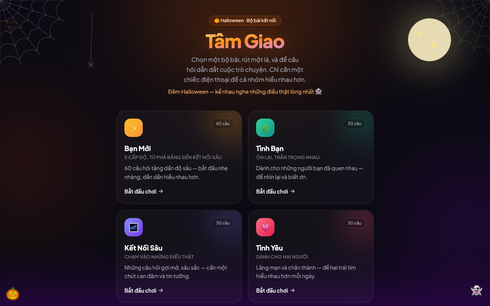
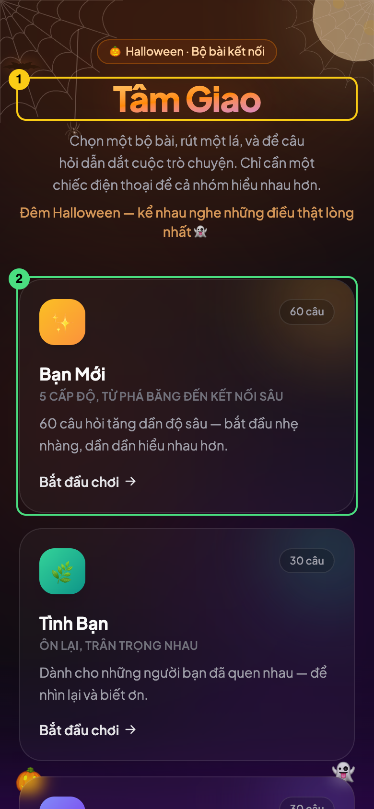
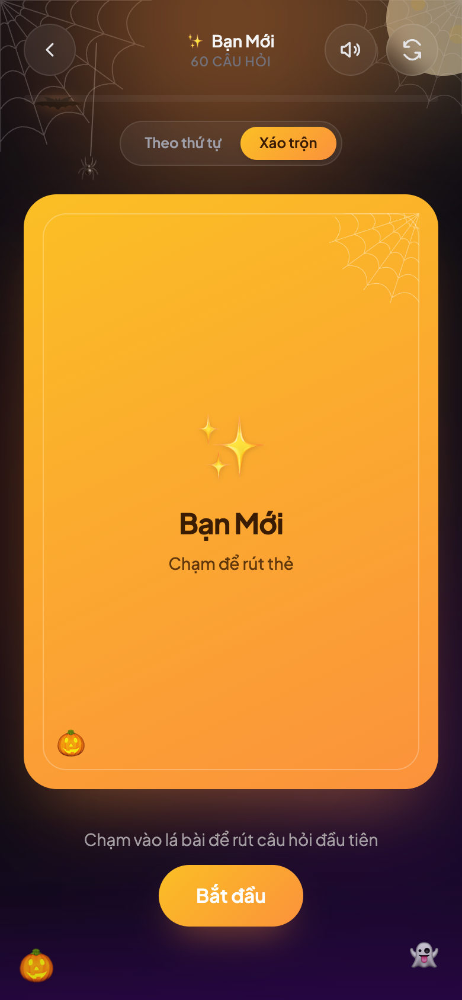
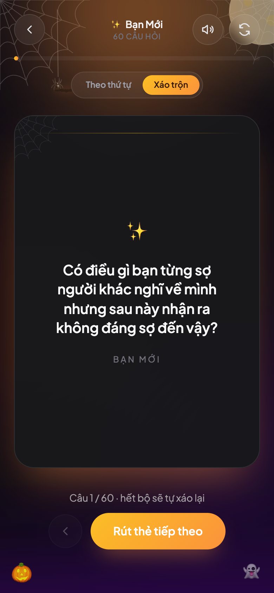
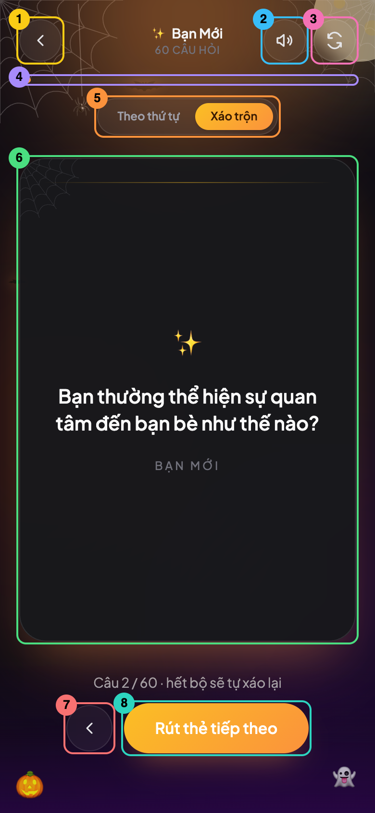
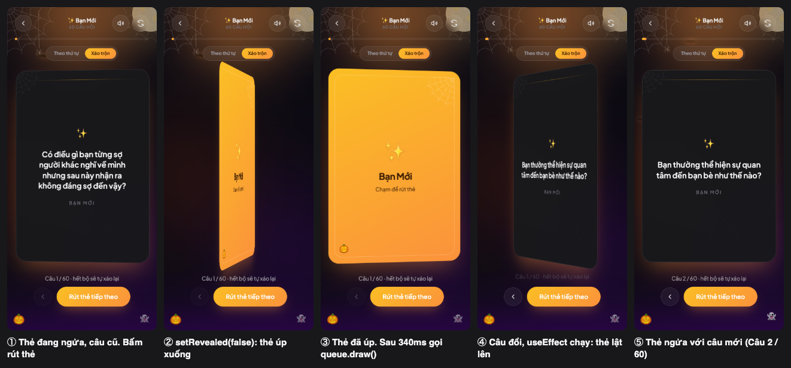
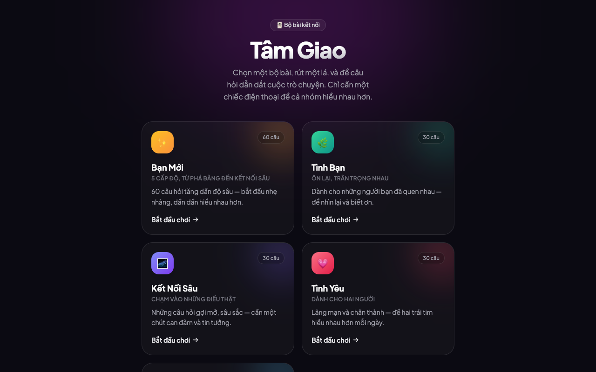

# Giải thích dự án Tâm Giao

**Tâm Giao** là web app chơi bài trò chuyện: cả nhóm chọn một bộ bài, rồi lần lượt rút thẻ và trả lời câu hỏi. Có 5 bộ với tổng 175 câu.

Dự án chỉ có frontend, không có backend hay database. Toàn bộ câu hỏi nằm sẵn trong code, còn tiến trình chơi lưu trong `localStorage` của trình duyệt.

## 1. Cách chạy

Máy bạn đã có Node và npm. Mở terminal tại thư mục dự án rồi chạy:

```bash
npm install    # tải thư viện vào node_modules (chỉ cần khi mới clone hoặc khi package.json đổi)
npm run dev    # chạy server phát triển
```

Khi chạy thành công, terminal sẽ in ra như sau:

```text
  VITE v8.3.0  ready in 189 ms

  ➜  Local:   http://localhost:5173/
  ➜  Network: http://192.168.x.x:5173/  en1
```

Sau đó mở `http://localhost:5173`. Khi bạn sửa code, trang sẽ tự cập nhật mà không cần tải lại. Muốn tắt server, nhấn `Ctrl + C` trong terminal.

| Lệnh | Tác dụng |
|---|---|
| `npm run dev` | Chạy để phát triển |
| `npm run build` | Kiểm tra kiểu TypeScript, rồi đóng gói thành web tĩnh trong `dist/` |
| `npm run preview` | Xem thử bản đã build |
| `npm run lint` | Quét lỗi code bằng oxlint |

Muốn mở trên điện thoại, hãy kết nối cùng Wi-Fi với máy tính rồi nhập địa chỉ `Network: http://192.168.x.x:5173` mà terminal in ra.

Tôi đã thử type-check, build và lint: cả ba đều không báo lỗi. Tôi cũng đã chạy app và chơi thử trên trình duyệt để chụp các ảnh trong tài liệu này.

## 2. Giao diện và các bước chơi

Các ảnh dưới đây được chụp từ app thật, khi đang bật trang trí Halloween. Câu hỏi bạn thấy có thể khác ảnh vì bộ bài được xáo ngẫu nhiên.

### Bước 1: Chọn bộ bài

Đây là màn hình đầu tiên khi mở app, do `DeckSelector` vẽ. Trên máy tính, các bộ bài xếp thành hai cột:



Trên điện thoại, chúng xếp thành một cột:



| Số | Phần giao diện | Code |
|---|---|---|
| 1 | Tiêu đề app | [DeckSelector.tsx:41-49](../src/components/DeckSelector.tsx#L41-L49) |
| 2 | Thẻ một bộ bài. Mỗi phần tử trong `decks` tạo ra một thẻ. Bấm vào để sang màn hình chơi | [DeckSelector.tsx:62-102](../src/components/DeckSelector.tsx#L62-L102) |

### Bước 2: Rút lá đầu tiên

Lá bài đang úp, chưa có câu hỏi. Bấm vào lá bài hoặc nút **Bắt đầu** đều rút được thẻ.



### Bước 3: Đọc câu hỏi và trả lời

Lá bài lật lên và hiện câu hỏi. Dòng chữ bên dưới cho biết bạn đang ở câu thứ mấy. Nút quay lại mờ đi vì đây là lá đầu tiên.



### Bước 4: Rút tiếp và dùng các nút điều khiển

Bấm vào lá bài hoặc nút **Rút thẻ tiếp theo** để sang câu mới. Các phần của màn hình chơi:



| Số | Phần giao diện | Tác dụng | Code |
|---|---|---|---|
| 1 | Nút quay lại | Về màn hình chọn bộ bài | [GameScreen.tsx:87](../src/components/GameScreen.tsx#L87) |
| 2 | Nút âm thanh | Bật hoặc tắt tiếng lật thẻ | [GameScreen.tsx:110](../src/components/GameScreen.tsx#L110) |
| 3 | Nút làm lại | Xáo lại bộ bài, hoặc bắt đầu lại từ câu đầu nếu đang ở chế độ "Theo thứ tự" | [GameScreen.tsx:129](../src/components/GameScreen.tsx#L129) |
| 4 | Thanh tiến trình | Cho biết đã rút được bao nhiêu phần của bộ bài | [GameScreen.tsx:149](../src/components/GameScreen.tsx#L149) |
| 5 | Chọn chế độ | Đổi giữa "Theo thứ tự" và "Xáo trộn" | [GameScreen.tsx:158](../src/components/GameScreen.tsx#L158) |
| 6 | Lá bài | Component `PlayingCard`; bấm vào để rút thẻ | [PlayingCard.tsx](../src/components/PlayingCard.tsx) |
| 7 | Xem lại lá trước | Quay về câu vừa rút | [GameScreen.tsx:210](../src/components/GameScreen.tsx#L210) |
| 8 | Rút thẻ tiếp theo | Sang câu mới | [GameScreen.tsx:223](../src/components/GameScreen.tsx#L223) |

Nền dơi, nhện, mạng nhện và bí ngô do `HalloweenDecor` vẽ, nằm phía sau tất cả các phần trên.

## 3. Công nghệ sử dụng

| Công cụ | Vai trò |
|---|---|
| **React** | Xây giao diện từ các component |
| **TypeScript** | JavaScript có kiểu, giúp bắt lỗi trước khi chạy |
| **Vite** | Chạy dev server và đóng gói code |
| **Tailwind CSS** | Viết CSS bằng class ngay trong JSX, ví dụ `flex rounded-full` |
| **Motion** | Làm animation như lật thẻ, mờ dần, dơi bay |
| **oxlint** | Kiểm tra lỗi và quy tắc viết code |

`clsx` có trong `package.json` nhưng code hiện không dùng đến.

## 4. Cấu trúc thư mục

```text
connect-card-game/
├── index.html            # Trang HTML duy nhất, chứa <div id="root">
├── package.json          # Danh sách thư viện và các lệnh npm
├── vite.config.ts        # Cấu hình Vite
├── tsconfig*.json        # Cấu hình TypeScript
├── .oxlintrc.json        # Cấu hình linter
├── public/favicon.svg    # File tĩnh, giữ nguyên khi build
├── node_modules/         # Thư viện đã tải (không commit)
├── dist/                 # Kết quả build (không commit)
└── src/                  # Code chính
    ├── main.tsx          # Điểm khởi động React
    ├── App.tsx           # Chọn màn hình cần hiển thị
    ├── index.css         # CSS toàn cục, nạp Tailwind
    ├── data/decks.ts     # Nội dung các bộ bài
    ├── theme/halloween.ts# Công tắc bật/tắt Halloween
    ├── hooks/
    │   ├── useDeckQueue.ts   # Logic rút bài
    │   └── useCardSound.ts   # Âm thanh lật thẻ
    └── components/
        ├── DeckSelector.tsx  # Màn hình chọn bộ bài
        ├── GameScreen.tsx    # Màn hình chơi
        ├── PlayingCard.tsx   # Lá bài lật 3D
        └── HalloweenDecor.tsx# Dơi, nhện, mạng nhện, bí ngô
```

Cách chia này tách riêng ba phần:
- **Dữ liệu:** `data/`
- **Logic:** `hooks/`
- **Giao diện:** `components/`

## 5. App khởi động thế nào

```text
index.html → main.tsx → App.tsx ─┬─ HalloweenDecor (nền trang trí)
                                 ├─ DeckSelector   (nếu chưa chọn bộ)
                                 └─ GameScreen     (nếu đã chọn bộ)
                                      ├─ useDeckQueue
                                      ├─ useCardSound
                                      └─ PlayingCard
```

1. [index.html:12-13](../index.html#L12-L13) tạo một thẻ `div` rỗng và nạp `main.tsx`.
2. [main.tsx:6-10](../src/main.tsx#L6-L10) cho React vẽ `<App />` vào thẻ `div` đó.
3. [App.tsx:10](../src/App.tsx#L10) giữ state `selectedDeckId`, quyết định màn hình nào được hiển thị:
   - `null`: hiện màn hình chọn bộ bài.
   - Có id: hiện màn hình chơi.

Dự án không dùng React Router, nên URL không đổi khi chuyển màn hình.

**Props truyền dữ liệu từ cha xuống con, còn callback báo sự kiện từ con lên cha.** Ví dụ khi bạn chọn một bộ bài:

```text
App truyền onSelect={setSelectedDeckId} xuống DeckSelector
→ người dùng bấm vào bộ bài
→ DeckSelector gọi onSelect(deck.id)
→ state của App đổi, React vẽ lại và hiện GameScreen
```

## 6. Các file quan trọng

### `data/decks.ts`: dữ liệu
[Interface `Deck`](../src/data/decks.ts#L3-L16) mô tả một bộ bài gồm tên, emoji, màu sắc và mảng `questions`. Giao diện tự vẽ theo mảng `decks`, nên thêm một object vào đó là có bộ bài mới mà không phải sửa component.

### `useDeckQueue.ts`: logic rút bài
Đây là file nên đọc kỹ nhất. Thay vì xóa câu đã rút, nó dùng một mảng thứ tự và một con trỏ:

```text
order:   [2, 0, 1]   // thứ tự rút, mỗi số là vị trí câu hỏi trong questions
pointer: 1           // đang ở phần tử thứ 2 của order, tức câu questions[0]
mode:    'shuffled'  // hoặc 'ordered'
```

| Hành động | Điều xảy ra |
|---|---|
| Rút thẻ ([`draw`](../src/hooks/useDeckQueue.ts#L67-L76)) | Tăng `pointer`; hết bộ thì tạo thứ tự mới và quay về đầu |
| Xem lại ([`goBack`](../src/hooks/useDeckQueue.ts#L83-L86)) | Giảm `pointer` |
| Chơi lại ([`reset`](../src/hooks/useDeckQueue.ts#L78-L81)) | Tạo thứ tự mới, đặt `pointer = -1` (chưa rút lá nào) |
| Đổi chế độ ([`setMode`](../src/hooks/useDeckQueue.ts#L89-L96)) | Giữ các lá đã rút, chỉ sắp xếp lại các lá còn lại |

Vì `order` và `pointer` được lưu lại, các lá đã rút không lặp lại và bạn tải lại trang vẫn chơi tiếp được. [Hàm `shuffled`](../src/hooks/useDeckQueue.ts#L10-L17) dùng thuật toán xáo bài Fisher–Yates. State được [lưu vào `localStorage`](../src/hooks/useDeckQueue.ts#L57-L63) mỗi khi thay đổi, với key dạng `tam-giao:ban-moi`.

Đây là giá trị thật của key đó sau khi rút 2 lá (đã rút gọn mảng `order`, thực tế có đủ 60 số). `pointer` là `1` vì vị trí được đếm từ 0:

```json
{"order":[51,34,56,53,47,...],"pointer":1,"mode":"shuffled"}
```

### `GameScreen.tsx`: điều phối màn hình chơi
Component này nối logic với giao diện. Nó có 3 giá trị đáng chú ý:

- **`revealed`:** lá bài đang ngửa hay úp.
- **`displayed`:** câu hỏi đang in trên thẻ, tách riêng khỏi `queue.currentQuestion`.
- **`pending`:** một `useRef`, dùng để chặn bấm liên tục trong lúc thẻ đang lật. Đổi ref không làm React vẽ lại.

`displayed` cần tách riêng để người chơi không thấy câu mới trước khi thẻ úp xuống. Khi bạn bấm rút thẻ lúc thẻ đang ngửa ([handleDraw](../src/components/GameScreen.tsx#L30-L43)):

```text
Bấm → pending = true, phát âm thanh
    → setRevealed(false): thẻ úp xuống
    → sau 340ms: phát âm thanh, queue.draw()
    → actionCount tăng, useEffect chạy
    → cập nhật displayed, setRevealed(true), pending = false
    → thẻ lật lên với câu mới
```

`actionCount` đếm số lần `draw`, `reset` và `goBack`. [useEffect](../src/components/GameScreen.tsx#L22-L28) theo dõi giá trị này thay vì nội dung câu hỏi, nên `pending` luôn được trả về `false`, kể cả khi câu hỏi không đổi.

Các bước trên trông như sau khi app chạy. Hãy để ý rằng câu hỏi chỉ đổi sau khi thẻ đã úp xuống:



### `PlayingCard.tsx`: lật thẻ 3D
Lá bài gồm hai mặt xếp chồng lên nhau:

- [`perspective`](../src/components/PlayingCard.tsx#L17) tạo chiều sâu.
- [`rotateY`](../src/components/PlayingCard.tsx#L24) xoay thẻ 0° hoặc 180° theo `revealed`.
- `backfaceVisibility: hidden` ẩn mặt đang quay ra sau.
- Mặt câu hỏi [xoay sẵn 180°](../src/components/PlayingCard.tsx#L67), nên nó hiện ra đúng chiều khi thẻ lật.

### `useCardSound.ts`: âm thanh
Dự án không có file nhạc nào. Âm thanh được tạo trực tiếp bằng Web Audio API: một tiếng "whoosh" từ nhiễu, cộng với tiếng chuông nốt C5 và G5 có vang. Phần đầu file xử lý riêng cho iOS. File này khá khó, nên bạn có thể đọc sau cùng.

### `HalloweenDecor.tsx` và `halloween.ts`
[`HALLOWEEN = true`](../src/theme/halloween.ts#L2) bật toàn bộ trang trí Halloween. Đổi thành `false` là tắt hết. Đây là một công tắc tính năng đơn giản. So với ảnh ở Bước 1, giao diện khi tắt không còn trăng, mạng nhện và dòng chữ Halloween:



## 7. Thứ tự nên đọc code

1. `index.html`, `main.tsx`, `App.tsx`: hiểu luồng khởi động.
2. Phần đầu `data/decks.ts`: hiểu hình dạng dữ liệu.
3. `DeckSelector.tsx`: component dễ nhất, có props và `.map()`.
4. `PlayingCard.tsx`: component nhận props và animation.
5. `useDeckQueue.ts`: state, effect và custom hook.
6. `GameScreen.tsx`: cách mọi phần ghép lại với nhau.
7. `HalloweenDecor.tsx` và `useCardSound.ts`: đọc thêm khi đã vững.

## 8. Bài tập để học

**Dễ**
1. Đổi `HALLOWEEN` thành `false` và xem giao diện thay đổi ra sao.
2. Thêm một câu hỏi vào bộ "Bạn Mới". Số câu ở màn hình chọn bài sẽ tự tăng.
3. Mở DevTools, vào **Application → Local Storage**, rồi xem `order` và `pointer` đổi thế nào khi rút thẻ.

**Trung bình**

4. Tự tạo một bộ bài mới với màu riêng.
5. Hiện dòng "Đã hết bộ!" bằng giá trị `isExhausted`. Hook đã trả về giá trị này nhưng giao diện chưa dùng.