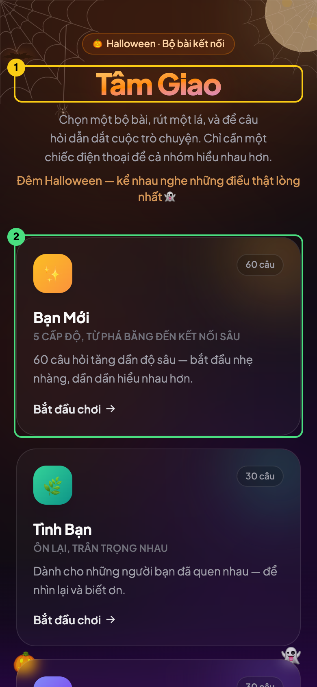

# 07. `DeckSelector`: props, danh sách, Tailwind và Motion

**File trong bài:** [src/components/DeckSelector.tsx](../src/components/DeckSelector.tsx)

**Sau bài này, bạn sẽ hiểu:** cách viết một component nhận props, cách vẽ danh sách, cách đọc class Tailwind và cách khai báo animation bằng Motion.

Component này **không có state và không có effect**. Với cùng props, nó luôn trả về cùng giao diện, nên đây là nơi lý tưởng để học phần hiển thị của React trước khi bước vào phần logic.



## 1. Props: hợp đồng giữa cha và con

```tsx
interface DeckSelectorProps {
  decks: Deck[]
  onSelect: (deckId: string) => void
}

export function DeckSelector({ decks, onSelect }: DeckSelectorProps) {
```

Interface này là hợp đồng: muốn dùng `DeckSelector`, bạn phải đưa một mảng `Deck` và một hàm. Phía `App` thực hiện đúng hợp đồng đó:

```tsx
<DeckSelector decks={decks} onSelect={setSelectedDeckId} />
```

### Destructuring trong tham số

React truyền tất cả props vào **một object duy nhất** làm tham số. Hai cách viết sau tương đương nhau:

```tsx
function DeckSelector(props: DeckSelectorProps) {
  props.decks.map(...)
}

function DeckSelector({ decks, onSelect }: DeckSelectorProps) {
  decks.map(...)
}
```

Cách thứ hai dùng object destructuring để lấy thẳng các trường ra thành biến.

### Hàm cũng là một kiểu dữ liệu

`onSelect: (deckId: string) => void` có nghĩa là "một hàm nhận một chuỗi và không cần trả về gì". `setSelectedDeckId` khớp với kiểu đó nên truyền được vào.

`DeckSelector` **không biết** khi được chọn thì điều gì sẽ xảy ra. Nó chỉ thông báo "bộ này được chọn". Vì thế cùng component này có thể được dùng trong một ngữ cảnh khác mà không cần sửa.

### Hai quy tắc của props

1. **Props là chỉ đọc.** Component con không được sửa props. Muốn đổi, nó phải gọi callback để báo cho cha.
2. **Dữ liệu đi một chiều.** Dữ liệu đi xuống qua props, sự kiện đi lên qua callback.

## 2. Vẽ danh sách bằng `.map()`

JSX không chạy được vòng lặp `for`, vì `for` là câu lệnh chứ không phải biểu thức. Thay vào đó, ta dùng `.map()` để biến mảng dữ liệu thành mảng JSX ([DeckSelector.tsx:62-102](../src/components/DeckSelector.tsx#L62-L102)):

```tsx
{decks.map((deck, index) => (
  <motion.button
    key={deck.id}
    type="button"
    onClick={() => onSelect(deck.id)}
    ...
  >
    ...
  </motion.button>
))}
```

### Vì sao danh sách cần `key`

Khi danh sách đổi, React cần biết phần tử nào ứng với phần tử nào so với lần trước. `key` là tên định danh của mỗi phần tử. Không có nó, React chỉ còn cách dựa vào vị trí: nếu chèn một phần tử vào đầu danh sách, React sẽ coi mọi phần tử đều đã đổi nội dung. State bên trong, nếu có, sẽ dính nhầm vào phần tử khác.

Một `key` tốt phải có hai tính chất: **ổn định** qua các lần render và **duy nhất** trong danh sách đó. `deck.id` thỏa mãn cả hai.

**Có nên dùng `index` làm key không?** Chỉ khi danh sách cố định, không bao giờ đổi thứ tự. [HalloweenDecor.tsx:92](../src/components/HalloweenDecor.tsx#L92) dùng `key={i}` là chấp nhận được vì `BATS` là một hằng số không đổi. Với danh sách có thể thay đổi, đừng dùng `index`.

### Closure trong `onClick`

```tsx
onClick={() => onSelect(deck.id)}
```

Mỗi lần lặp tạo ra một hàm riêng, và mỗi hàm "nhớ" `deck` của lần lặp đó. Nhờ vậy, năm nút bấm gọi `onSelect` với năm id khác nhau. Khả năng hàm nhớ biến ở nơi nó được tạo ra gọi là **closure**.

## 3. Cấu trúc của màn hình

```text
<div>                       Khung ngoài: chiều cao tối thiểu bằng màn hình
├── <div aria-hidden>       Quầng sáng trên (chỉ trang trí)
├── <div aria-hidden>       Quầng sáng dưới (chỉ trang trí)
├── <motion.header>         Tiêu đề, mô tả
├── <div>                   Lưới các bộ bài
│   └── <motion.button> × 5 Mỗi bộ một nút
└── <motion.p>              Dòng mẹo cuối trang
```

Mỗi bộ bài là một `button` thật chứ không phải `div` gắn `onClick`. Nhờ vậy nó tự có khả năng focus bằng phím Tab, kích hoạt bằng Enter, và được trình đọc màn hình đọc là nút bấm. Hãy chọn thẻ HTML đúng ý nghĩa trước khi nghĩ đến kiểu dáng.

`type="button"` cũng là một thói quen tốt: trong một `form`, nút mặc định có kiểu `submit`. Còn `aria-hidden` báo cho trình đọc màn hình bỏ qua các phần tử chỉ để trang trí.

## 4. Tailwind CSS: đọc class như đọc câu

Tailwind cung cấp sẵn các class nhỏ, mỗi class làm một việc. Thay vì viết CSS riêng, bạn ghép chúng ngay trong JSX:

```tsx
<div className="relative flex min-h-dvh flex-col overflow-hidden px-5 pb-12">
```

```text
relative         position: relative
flex             display: flex
min-h-dvh        chiều cao tối thiểu 100dvh
flex-col         xếp các con theo chiều dọc
overflow-hidden  cắt phần tràn ra ngoài
px-5             padding trái phải 1.25rem
pb-12            padding dưới 3rem
```

### Bảng từ vựng nhanh

| Nhóm | Ví dụ | Ý nghĩa |
|---|---|---|
| Khoảng cách | `p-5`, `px-5`, `mt-4`, `gap-4` | Padding, margin, khoảng cách. Mỗi đơn vị bằng `0.25rem` |
| Kích thước | `h-12`, `w-full`, `max-w-md` | Cao, rộng, rộng tối đa |
| Bố cục | `flex`, `grid`, `items-center`, `justify-between` | Flexbox và Grid |
| Vị trí | `relative`, `absolute`, `-top-40`, `inset-0`, `z-10` | Định vị |
| Chữ | `text-sm`, `font-bold`, `text-zinc-400` | Cỡ, độ đậm, màu |
| Nền, viền | `bg-white/5`, `border`, `rounded-3xl` | Nền, viền, bo góc |
| Hiệu ứng | `blur-2xl`, `backdrop-blur`, `shadow-lg` | Làm mờ, bóng đổ |

### Các cú pháp đặc biệt

| Cú pháp | Ví dụ | Ý nghĩa |
|---|---|---|
| Độ trong suốt `/n` | `bg-white/5` | Nền trắng, độ đậm 5% |
| Giá trị tùy ý `[...]` | `w-[36rem]`, `blur-[110px]` | Giá trị không có sẵn trong thang |
| Tiền tố màn hình | `sm:grid-cols-2`, `sm:text-5xl` | Chỉ áp dụng khi rộng từ 640px |
| Tiền tố trạng thái | `hover:border-white/20` | Chỉ áp dụng khi di chuột vào |
| Đánh dấu nhóm | `group` và `group-hover:opacity-50` | Con đổi kiểu khi di chuột vào **cha** |

### Thiết kế ưu tiên điện thoại

Tiền tố `sm:` nghĩa là "từ 640px trở lên", chứ không phải "trên màn hình nhỏ". Vì thế:

```tsx
<div className="grid gap-4 sm:grid-cols-2">
```

Mặc định là một cột, và từ 640px trở lên là hai cột. Bạn viết cho điện thoại trước, rồi thêm tiền tố cho màn hình lớn. Điều này phù hợp với app dự định dùng trên điện thoại.

### `group`: con phản ứng theo cha

```tsx
<motion.button className="group ...">
  <div className="... opacity-30 transition group-hover:opacity-50" />
  ...
  <svg className="... transition group-hover:translate-x-0.5">
```

Khi di chuột lên nút, quầng sáng đậm lên và mũi tên dịch sang phải một chút.

### `min-h-dvh` và vùng an toàn

- `dvh` là "chiều cao viewport động": trên điện thoại, nó tự điều chỉnh theo thanh địa chỉ đang hiện hay ẩn, còn `vh` thì thường bị lệch.
- `pt-[calc(env(safe-area-inset-top,0px)+2.5rem)]` tạo khoảng đệm phía trên bằng độ cao tai thỏ cộng 2.5rem. Khoảng này cần thiết vì `index.html` đã đặt `viewport-fit=cover`.

### Tailwind tĩnh và `style` động

Đây là điểm dễ hỏng nhất khi làm việc với Tailwind. Hãy so sánh:

```tsx
// ✅ Đúng cách dự án đang làm
style={{ background: `linear-gradient(135deg, ${deck.from}, ${deck.to})` }}

// ❌ Sẽ KHÔNG hoạt động
className={`bg-[${deck.from}]`}
```

**Tailwind đọc code như đọc văn bản lúc build**, chứ không chạy code. Nó chỉ thấy chuỗi `bg-[${deck.from}]`, không biết giá trị thực là gì, nên không sinh ra CSS nào. Từ đó có quy tắc:

| Loại giá trị | Dùng cách nào | Ví dụ |
|---|---|---|
| Tĩnh, hoặc vài lựa chọn biết trước | `className` | `HALLOWEEN ? 'bg-orange-500/20' : 'bg-fuchsia-500/20'` |
| Chỉ biết lúc chạy, phụ thuộc dữ liệu | `style` | Màu của từng bộ bài |

Cách viết `HALLOWEEN ? 'bg-orange-500/20' : 'bg-fuchsia-500/20'` hoạt động vì cả hai tên class đều xuất hiện **nguyên vẹn** trong code nguồn. Cùng lý do đó, `size: 'w-10'` trong mảng dữ liệu `BATS` cũng được Tailwind nhận ra.

Template literal `` `...${x}...` `` là cách ghép chuỗi của JavaScript. Nó được dùng rất nhiều ở đây để ghép class cố định với class có điều kiện.

## 5. Motion: animation khai báo

Với Motion, bạn thêm tiền tố `motion.` vào thẻ HTML rồi khai báo trạng thái, thư viện lo phần chuyển động ở giữa:

```tsx
<motion.button
  initial={{ opacity: 0, y: 16 }}                       // Lúc bắt đầu: trong suốt, lệch xuống 16px
  animate={{ opacity: 1, y: 0 }}                        // Đích đến: hiện rõ, đúng vị trí
  transition={{ duration: 0.45, delay: index * 0.07 }}  // Trong 0,45 giây, có độ trễ
  whileHover={{ y: -4 }}                                // Khi di chuột: nhấc lên 4px
  whileTap={{ scale: 0.97 }}                            // Khi nhấn: thu nhỏ một chút
>
```

Đây cũng là cách nghĩ khai báo của React: bạn mô tả trạng thái chứ không tự viết từng khung hình. Khi giá trị trong `animate` thay đổi, Motion tự chuyển từ trạng thái hiện tại sang trạng thái mới.

**`delay: index * 0.07`** tạo hiệu ứng so le: bộ thứ nhất xuất hiện ngay, bộ thứ hai trễ 0,07 giây, bộ thứ ba trễ 0,14 giây, và cứ thế tiếp tục. Tất cả chỉ nhờ tham số `index` có sẵn của `.map()`.

## 6. Quầng sáng và lớp chồng

Hai `div` đầu tiên tạo ánh sáng mờ ở nền:

```tsx
<div className="pointer-events-none absolute -top-40 left-1/2 h-96 w-[36rem] -translate-x-1/2 rounded-full blur-[110px] ..." aria-hidden />
```

Đây là một hình tròn lớn được làm mờ rất mạnh. `left-1/2 -translate-x-1/2` là kỹ thuật canh giữa kinh điển: đưa mép trái ra giữa, rồi lùi lại một nửa chiều rộng của chính nó. `pointer-events-none` làm cho nó không chặn các cú click vào những thứ bên dưới.

Nội dung chính có `relative z-10` để nằm trên các lớp trang trí. Khung ngoài cũng có `overflow-hidden` nên quầng sáng không gây ra thanh cuộn ngang.

## Thử ngay

1. Đổi `index * 0.07` thành `index * 0.5` để thấy rõ hiệu ứng so le.
2. Đổi `sm:grid-cols-2` thành `grid-cols-3` rồi thu nhỏ cửa sổ. Giao diện sẽ chật trên điện thoại, cho thấy vì sao cần viết theo hướng ưu tiên điện thoại.
3. Bỏ `key={deck.id}`. Console sẽ cảnh báo thiếu `key`. App trông vẫn bình thường vì danh sách này không đổi, nhưng đừng vì thế mà bỏ qua cảnh báo.
4. Tạm thay `style={{ background: ... }}` của ô emoji bằng ``className={`bg-[${deck.from}]`}``. Nền của ô sẽ không có màu. Đây là minh chứng cho việc Tailwind không chạy code của bạn.
5. Đổi `onSelect` trong `App` thành `onSelect={(id) => alert(id)}`. `DeckSelector` không cần sửa dòng nào. Đây chính là ích lợi của callback.

## Tự kiểm tra

<details>
<summary>1. Vì sao <code>DeckSelector</code> không tự gọi <code>setSelectedDeckId</code>?</summary>

Vì state đó thuộc về `App`, và nó không được truyền xuống dưới tên đó. `DeckSelector` chỉ biết có một hàm `onSelect`. Sự tách biệt này giúp nó dùng lại được và không phụ thuộc vào cách cha xử lý.
</details>

<details>
<summary>2. <code>sm:text-5xl</code> có nghĩa là gì trên một điện thoại rộng 390px?</summary>

Không có tác dụng gì. Tiền tố `sm:` chỉ áp dụng từ 640px trở lên. Trên điện thoại, class `text-4xl` đang có sẽ được dùng.
</details>

<details>
<summary>3. Dùng <code>style</code> cho màu của bộ bài, vì sao không tạo sẵn class Tailwind cho từng màu?</summary>

Làm vậy thì mỗi lần thêm bộ bài đều phải sửa thêm ở nơi định nghĩa class. Khi đặt màu trong dữ liệu và dùng `style`, thêm một object là đủ, giữ được tính chất data-driven đã nói ở bài trước.
</details>

<details>
<summary>4. Vì sao màn hình này không cần <code>useState</code>?</summary>

Nó không có dữ liệu nào đổi theo thời gian mà phải tự nhớ. Trạng thái "đang chọn bộ nào" thuộc về `App`, còn hiệu ứng hover và animation do CSS và Motion lo.
</details>

---

**Bài tiếp theo:** [08. PlayingCard](08-playing-card.md)
