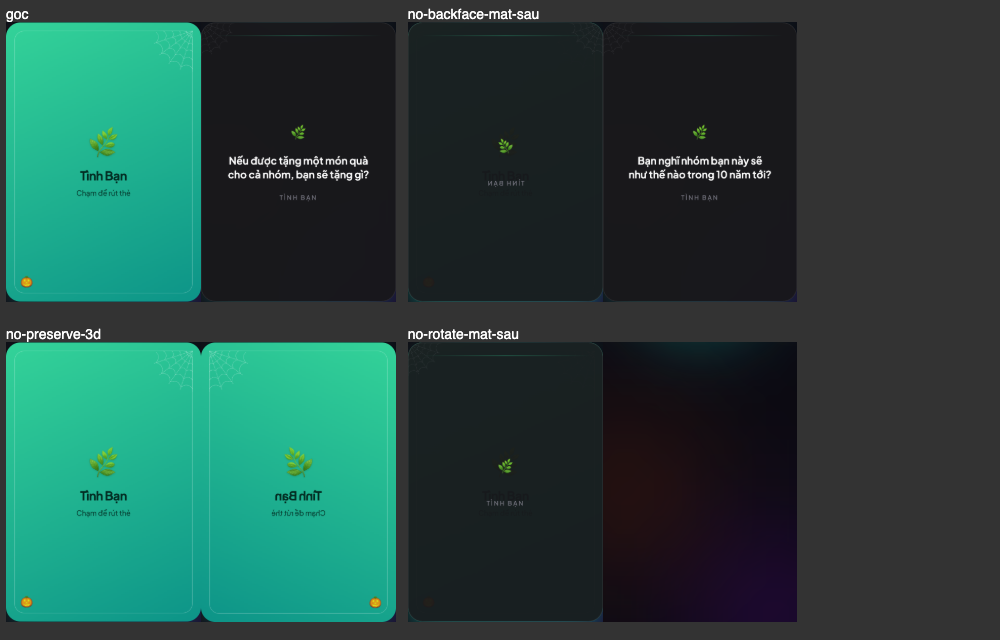

# 08-00. Đọc từng dòng `PlayingCard.tsx`

**File trong bài:** [src/components/PlayingCard.tsx](../src/components/PlayingCard.tsx)

Bài này đi qua từng dòng của component lá bài, từ trên xuống dưới, để bạn hiểu **mỗi dòng làm gì**. Sau đó, [bài 08](08-playing-card.md) sẽ phân tích sâu hơn về vai trò của component và đường cong animation.

## Trước khi đọc: ý tưởng của file

Lá bài có hai mặt xếp chồng lên nhau, và cả hai luôn nằm trên trang. Thân lá bài xoay quanh trục dọc để đổi mặt nhìn thấy:

```text
<div>                           Khung ngoài, tạo chiều sâu 3D
└── <motion.button>             Thân lá bài, đây là phần xoay
    ├── <div> Mặt trước         Bìa: màu của bộ bài, emoji, tên
    └── <div> Mặt sau           Câu hỏi
```

- `revealed = false`: thân ở góc 0°, bạn thấy bìa.
- `revealed = true`: thân ở góc 180°, bạn thấy câu hỏi.

## Bản đồ của file

```text
Dòng 1-4     Import
Dòng 6-11    Kiểu của props
Dòng 13      Khai báo component
Dòng 15-18   Khung ngoài
Dòng 19-28   Thân lá bài, nơi có animation
Dòng 29-60   Mặt trước
Dòng 62-85   Mặt sau
Dòng 86-89   Đóng thẻ
```

## 1. Import ([dòng 1-4](../src/components/PlayingCard.tsx#L1-L4))

```tsx
import { motion } from 'motion/react'
import type { Deck } from '../data/decks'
import { HALLOWEEN } from '../theme/halloween'
import { SpiderWeb } from './HalloweenDecor'
```

| Dòng | Lấy gì | Để làm gì |
|---|---|---|
| 1 | `motion` | Tạo thẻ có animation, ở đây là `motion.button` |
| 2 | Kiểu `Deck` | Khai báo kiểu cho prop `deck`. `import type` nghĩa là chỉ lấy kiểu |
| 3 | `HALLOWEEN` | Công tắc bật tắt phần trang trí |
| 4 | `SpiderWeb` | Component vẽ mạng nhện |

File này không import gì từ `react`, vì component không dùng hook nào. Việc dùng JSX cũng không cần import React, nhờ cấu hình `"jsx": "react-jsx"`.

## 2. Kiểu của props ([dòng 6-11](../src/components/PlayingCard.tsx#L6-L11))

```tsx
interface PlayingCardProps {
  deck: Deck
  question: string | null
  revealed: boolean
  onDraw: () => void
}
```

Đây là những gì component cha phải truyền vào:

| Prop | Kiểu | Ý nghĩa |
|---|---|---|
| `deck` | `Deck` | Bộ bài, để lấy tên, emoji và màu sắc |
| `question` | Chuỗi hoặc `null` | Câu hỏi in trên mặt sau. `null` khi chưa rút lá nào |
| `revealed` | `true` hoặc `false` | Lá bài đang ngửa hay úp |
| `onDraw` | Hàm không nhận tham số, không trả về gì | Hàm được gọi khi người dùng bấm vào lá bài |

`GameScreen` sử dụng component này như sau ([GameScreen.tsx:188](../src/components/GameScreen.tsx#L188)):

```tsx
<PlayingCard deck={deck} question={displayed} revealed={revealed} onDraw={handleDraw} />
```

## 3. Khai báo component ([dòng 13-14](../src/components/PlayingCard.tsx#L13-L14))

```tsx
export function PlayingCard({ deck, question, revealed, onDraw }: PlayingCardProps) {
  return (
```

Component là một hàm trả về JSX. React truyền props vào dưới dạng một object, và `{ deck, question, ... }` lấy từng trường ra thành biến. `: PlayingCardProps` khai báo kiểu của object đó.

Component không có `useState`, nên nó chỉ hiển thị theo props. `GameScreen` đổi `revealed`, và lá bài lật theo.

## 4. Khung ngoài ([dòng 15-18](../src/components/PlayingCard.tsx#L15-L18))

```tsx
    <div
      className="relative mx-auto w-full max-w-sm select-none"
      style={{ perspective: '1800px' }}
    >
```

| Class hoặc style | Ý nghĩa |
|---|---|
| `relative` | Dùng làm mốc định vị |
| `mx-auto` | Canh giữa theo chiều ngang |
| `w-full` | Rộng hết chỗ có sẵn |
| `max-w-sm` | Rộng tối đa `24rem`, khoảng 384px |
| `select-none` | Không cho bôi đen chữ, tránh việc chạm vào lá bài lại chọn nhầm văn bản |
| `perspective: '1800px'` | Đặt vị trí mắt nhìn, để cú xoay có cảm giác xa gần |

Số `1800px` càng nhỏ thì mắt nhìn càng gần, và hiệu ứng 3D càng mạnh. `perspective` đặt ở thẻ cha, và có tác dụng lên thẻ con đang xoay.

## 5. Thân lá bài ([dòng 19-28](../src/components/PlayingCard.tsx#L19-L28))

Đây là phần quan trọng nhất của file.

```tsx
      <motion.button
        type="button"
        onClick={onDraw}
        className="relative block aspect-[3/4.3] w-full cursor-pointer rounded-[28px] text-left outline-none"
        style={{ transformStyle: 'preserve-3d' }}
        animate={{ rotateY: revealed ? 180 : 0 }}
        transition={{ duration: 0.65, ease: [0.22, 1, 0.36, 1] }}
        whileTap={{ scale: 0.97 }}
        aria-label={revealed ? 'Rút thẻ tiếp theo' : 'Chạm để rút thẻ'}
      >
```

Từng dòng có ý nghĩa như sau:

**`motion.button`** là một thẻ `<button>` có thêm khả năng tạo animation.

**`type="button"`** khai báo đây là nút bấm thường, không phải nút gửi form.

**`onClick={onDraw}`** gọi hàm mà cha đã truyền vào khi người dùng bấm. Lá bài không biết việc rút thẻ diễn ra thế nào.

**`className`** gồm các class sau:

| Class | Ý nghĩa |
|---|---|
| `relative` | Làm mốc để hai mặt định vị bên trong |
| `block` | Hiển thị dạng khối, chiếm trọn hàng |
| `aspect-[3/4.3]` | Giữ tỉ lệ rộng trên cao là 3 trên 4,3 |
| `w-full` | Rộng bằng khung ngoài |
| `cursor-pointer` | Con trỏ chuột dạng bàn tay |
| `rounded-[28px]` | Bo góc 28px |
| `text-left` | Bỏ canh giữa mặc định của nút |
| `outline-none` | Bỏ viền focus mặc định |

Khi chạy trên màn hình rộng 420px, tôi đo được lá bài rộng 380px và cao 545px, đúng với tỉ lệ này. Lưu ý rằng `outline-none` làm người dùng bàn phím khó thấy nút nào đang được focus.

**`style={{ transformStyle: 'preserve-3d' }}`** cho hai mặt con giữ vị trí riêng trong không gian 3D. Nếu thiếu, hai mặt bị ép phẳng vào thân.

**`animate={{ rotateY: revealed ? 180 : 0 }}`** là dòng tạo ra cú lật. `rotateY` là góc xoay quanh trục dọc. Khi `revealed` đổi, Motion tự chuyển từ góc hiện tại sang góc mới.

**`transition={{ duration: 0.65, ease: [0.22, 1, 0.36, 1] }}`** quy định cú lật kéo dài 0,65 giây. Bốn số trong `ease` mô tả tốc độ: rất nhanh lúc đầu, chậm dần về cuối.

**`whileTap={{ scale: 0.97 }}`** thu nhỏ lá bài còn 97% trong lúc đang nhấn.

**`aria-label`** là tên của nút dành cho trình đọc màn hình, và đổi theo trạng thái lá bài.

## 6. Mặt trước: phần khung ([dòng 29-37](../src/components/PlayingCard.tsx#L29-L37))

```tsx
        {/* Front face — deck cover */}
```

Đây là cách viết comment trong JSX: phải đặt `/* */` trong dấu `{ }`. Comment này cho biết phần dưới đây là bìa của bộ bài.

```tsx
        <div
          className="absolute inset-0 flex flex-col items-center justify-center gap-5 rounded-[28px] p-8 text-center shadow-2xl"
          style={{
            backfaceVisibility: 'hidden',
            background: `linear-gradient(155deg, ${deck.from}, ${deck.to})`,
            boxShadow: `0 30px 60px -20px ${deck.glow}`,
          }}
        >
```

| Class | Ý nghĩa |
|---|---|
| `absolute inset-0` | Phủ kín thân lá bài. Hai mặt đều dùng class này nên chồng khít lên nhau |
| `flex flex-col` | Xếp các phần tử con theo chiều dọc |
| `items-center justify-center` | Canh giữa theo cả hai chiều |
| `gap-5` | Khoảng cách giữa các phần tử con |
| `rounded-[28px]` | Bo góc bằng thân lá bài |
| `p-8` | Khoảng đệm bên trong |
| `text-center` | Canh giữa chữ |
| `shadow-2xl` | Bóng đổ, nhưng `boxShadow` trong `style` sẽ được ưu tiên hơn |

Ba thuộc tính trong `style`:

- **`backfaceVisibility: 'hidden'`** ẩn mặt này khi nó quay lưng lại với người xem. Đây là chìa khóa để chỉ thấy một mặt tại một thời điểm.
- **`background`** tô màu chuyển từ `deck.from` sang `deck.to`, theo góc 155°.
- **`boxShadow`** tạo bóng đổ phát sáng theo màu của bộ bài.

Màu nằm trong `style` vì chúng đến từ dữ liệu lúc chạy. Tailwind quét code lúc build, nên không tạo được class từ các giá trị như vậy.

## 7. Mặt trước: viền và trang trí ([dòng 38-44](../src/components/PlayingCard.tsx#L38-L44))

```tsx
          <div className="absolute inset-4 rounded-[20px] border border-white/25" />
```

Đường viền trắng mờ bên trong bìa, cách mép lá bài `1rem` ở mọi phía. Thẻ không có nội dung nên được đóng ngay bằng `/>`.

```tsx
          {HALLOWEEN && (
            <>
              <SpiderWeb className="absolute right-4 top-4 h-20 w-20 rounded-tr-[20px] text-white/40" flip />
              <span className="absolute bottom-6 left-7 text-2xl opacity-90">🎃</span>
            </>
          )}
```

Nếu `HALLOWEEN` là `true`, hiển thị hai thứ: mạng nhện ở góc trên phải và trái bí ngô ở góc dưới trái.

- **`<>...</>`** gom hai phần tử lại, vì `&&` chỉ trả về được một giá trị.
- **`flip`** là cách viết tắt của `flip={true}`, làm mạng nhện lật ngang để khớp với góc phải.
- **`text-white/40`** đặt màu của mạng nhện, vì nét vẽ SVG lấy theo màu chữ hiện tại.

## 8. Mặt trước: nội dung ([dòng 45-60](../src/components/PlayingCard.tsx#L45-L60))

```tsx
          <span className="text-6xl drop-shadow-sm">{deck.emoji}</span>
```

Emoji của bộ bài, cỡ rất lớn, có bóng nhẹ.

```tsx
          <div>
            <p
              className="text-2xl font-bold tracking-tight"
              style={{ color: deck.textOnAccent }}
            >
              {deck.title}
            </p>
```

Tên bộ bài, chữ to và đậm. Màu chữ lấy từ `deck.textOnAccent`, là màu được chọn riêng để dễ đọc trên nền của bộ bài đó.

```tsx
            <p
              className="mt-2 text-sm font-medium opacity-80"
              style={{ color: deck.textOnAccent }}
            >
              Chạm để rút thẻ
            </p>
          </div>
        </div>
```

Dòng hướng dẫn, nhỏ và hơi mờ. Hai thẻ đóng ở cuối kết thúc khối chữ và cả mặt trước.

## 9. Mặt sau: phần khung ([dòng 62-70](../src/components/PlayingCard.tsx#L62-L70))

```tsx
        {/* Back face — question */}
        <div
          className="absolute inset-0 flex flex-col items-center justify-center gap-6 rounded-[28px] border border-white/10 bg-zinc-900/95 p-8 text-center shadow-2xl"
          style={{
            backfaceVisibility: 'hidden',
            transform: 'rotateY(180deg)',
            boxShadow: `0 30px 60px -20px ${deck.glow}`,
          }}
        >
```

Khung giống mặt trước, nhưng có nền tối `bg-zinc-900/95` và viền mờ.

Dòng quan trọng nhất là **`transform: 'rotateY(180deg)'`**: mặt sau được xoay sẵn 180°. Hãy cộng góc của thân với góc của từng mặt:

| `revealed` | Góc thân | Tổng ở mặt trước | Tổng ở mặt sau | Bạn thấy |
|---|---|---|---|---|
| `false` | 0° | 0°, hướng về bạn | 180°, quay lưng, bị ẩn | Bìa |
| `true` | 180° | 180°, quay lưng, bị ẩn | 360°, hướng về bạn | Câu hỏi |

Nhờ đó, câu hỏi hiện ra đúng chiều chứ không bị ngược.

## 10. Mặt sau: nội dung ([dòng 71-85](../src/components/PlayingCard.tsx#L71-L85))

```tsx
          <div
            className="absolute inset-x-6 top-6 h-px opacity-40"
            style={{ background: `linear-gradient(90deg, transparent, ${deck.from}, transparent)` }}
          />
```

Một đường kẻ mảnh ở phía trên, cao 1px. Màu của nó mờ ở hai đầu và rõ ở giữa.

```tsx
          {HALLOWEEN && (
            <SpiderWeb className="absolute left-0 top-0 h-16 w-16 rounded-tl-[28px] text-zinc-400/20" />
          )}
```

Mạng nhện mờ ở góc trên trái. Chỉ có một phần tử nên không cần `<>...</>`.

```tsx
          <span className="text-3xl">{deck.emoji}</span>
```

Emoji của bộ bài, nhỏ hơn so với ở mặt trước.

```tsx
          <p className="text-balance text-xl font-semibold leading-snug text-zinc-50 sm:text-2xl">
            {question}
          </p>
```

Đây là câu hỏi, phần quan trọng nhất của mặt sau.

- `text-balance` chia đều độ dài các dòng.
- `text-xl` là cỡ chữ trên điện thoại, còn `sm:text-2xl` là cỡ chữ từ 640px trở lên.
- `leading-snug` đặt khoảng cách dòng hơi sát.

Khi `question` là `null`, React không vẽ gì, nên thẻ `<p>` trống. Điều này không ảnh hưởng vì lúc đó mặt sau đang bị ẩn.

```tsx
          <span className="text-xs font-medium uppercase tracking-[0.2em] text-zinc-500">
            {deck.title}
          </span>
        </div>
```

Tên bộ bài ở dưới cùng, chữ nhỏ, viết hoa, giãn cách rộng. Thẻ `</div>` kết thúc mặt sau.

## 11. Đóng thẻ ([dòng 86-89](../src/components/PlayingCard.tsx#L86-L89))

```tsx
      </motion.button>
    </div>
  )
}
```

Lần lượt đóng thân lá bài, khung ngoài, câu lệnh `return` và hàm component.

## 12. Trên trình duyệt, lá bài trông thế nào?

Tôi mở app với bộ "Tình Bạn" và xem HTML thật của lá bài khi đang úp (đã rút gọn):

```html
<div class="relative mx-auto w-full max-w-sm select-none" style="perspective: 1800px;">
  <button type="button" class="..." aria-label="Chạm để rút thẻ" tabindex="0"
          style="transform-style: preserve-3d; transform: none;">
    <div class="absolute inset-0 ..." style="backface-visibility: hidden; ...">Bìa</div>
    <div class="absolute inset-0 ..." style="backface-visibility: hidden; transform: rotateY(180deg); ...">
      ...
      <p class="text-balance ..."></p>
      ...
    </div>
  </button>
</div>
```

Khi đã ngửa, chỉ có hai điểm đổi:

```html
<button ... aria-label="Rút thẻ tiếp theo" style="transform-style: preserve-3d; transform: rotateY(180deg);">
```

Và thẻ `<p>` lúc này có nội dung câu hỏi.

Có ba điều đáng chú ý:

- **`motion.button` trở thành `<button>`.** `animate`, `transition`, `whileTap` không xuất hiện trong HTML. Ngược lại, `tabindex` không được viết trong file này, mà do Motion thêm vào.
- **Cả hai mặt luôn nằm trên trang.** Mặt bị che chỉ được ẩn bằng CSS.
- **Có thể thấy góc xoay thay đổi.** Trong lúc lật, `transform` đổi liên tục, ví dụ tôi đọc được các giá trị `rotateY(19.671deg)`, `rotateY(112.687deg)`, `rotateY(155.569deg)`, `rotateY(172.227deg)`. Khác với hiệu ứng mờ ở [bài 05-00](05-00-doc-hieu-code-app.md#motiondiv-hoạt-động-thế-nào), bạn có thể nhìn thấy giá trị này chạy trong tab Elements.

## 13. Xóa từng dòng 3D thì sao?

Tôi lần lượt xóa từng thuộc tính trên một bản sao của app, rồi chụp lại lá bài khi đang úp (bên trái) và khi đang ngửa (bên phải):



| Ảnh | Đã xóa | Khi úp | Khi ngửa |
|---|---|---|---|
| `goc` | Không xóa gì | Bìa, đúng | Câu hỏi, đúng |
| `no-backface-mat-sau` | `backfaceVisibility` ở mặt sau | Mặt sau đè lên bìa, chữ bị ngược | Câu hỏi, đúng |
| `no-preserve-3d` | `transformStyle: 'preserve-3d'` | Bìa, đúng | **Bìa bị ngược**, không thấy câu hỏi |
| `no-rotate-mat-sau` | `transform: 'rotateY(180deg)'` ở mặt sau | Mặt sau đè lên bìa | **Không thấy gì**, cả hai mặt đều quay lưng |

Như vậy, mỗi thuộc tính này đều cần thiết để lá bài lật đúng.

## Toàn bộ quá trình khi lá bài lật

```text
1. Người dùng bấm vào lá bài
2. motion.button gọi onDraw, chính là handleDraw của GameScreen
3. GameScreen đổi revealed từ false thành true
4. React gọi lại PlayingCard với props mới
5. animate đổi từ { rotateY: 0 } thành { rotateY: 180 }
6. Motion xoay thân từ 0° sang 180° trong 0,65 giây
7. Qua mốc 90°, bìa quay lưng nên bị ẩn, còn mặt sau hiện ra
```

## Tự kiểm tra

<details>
<summary>1. Vì sao file này không cần <code>import</code> gì từ <code>react</code>?</summary>

Vì component không dùng hook nào, và cấu hình `"jsx": "react-jsx"` cho phép dùng JSX mà không cần import React.
</details>

<details>
<summary>2. Hai mặt chồng lên nhau bằng cách nào?</summary>

Cả hai đều có `absolute inset-0`, nên cùng phủ kín thân lá bài, vốn có class `relative`.
</details>

<details>
<summary>3. Vì sao màu của bìa nằm trong <code>style</code> mà không dùng class Tailwind?</summary>

Vì màu đến từ dữ liệu `deck` lúc chạy. Tailwind sinh CSS lúc build bằng cách đọc code như văn bản, nên không biết các giá trị đó.
</details>

<details>
<summary>4. Dòng nào làm lá bài lật khi <code>revealed</code> đổi?</summary>

`animate={{ rotateY: revealed ? 180 : 0 }}`. Motion thấy giá trị đích đổi nên tự chạy animation.
</details>

<details>
<summary>5. Lá bài đang úp, câu hỏi có nằm trong HTML không?</summary>

Thẻ `<p>` luôn có trong HTML. Nếu đang úp mà trước đó đã có câu hỏi, chẳng hạn trong lúc đang chuyển lá, nội dung vẫn nằm đó và chỉ bị che bằng CSS. Khi chưa rút lá nào, `question` là `null` nên thẻ trống.
</details>

---

**Bài tiếp theo:** [08. PlayingCard: phân tích](08-playing-card.md)
