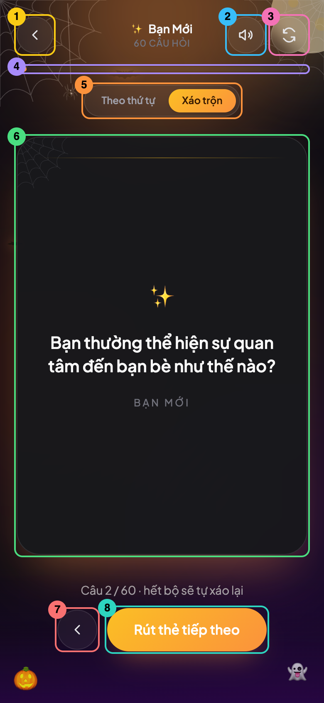

# 10-00. Đọc từng dòng `GameScreen.tsx`

**File trong bài:** [src/components/GameScreen.tsx](../src/components/GameScreen.tsx)

Bài này đi qua từng dòng của màn hình chơi, từ trên xuống dưới, để bạn hiểu **mỗi dòng làm gì**. Sau đó, [bài 10](10-game-screen.md) sẽ giải thích sâu hơn về **lý do thiết kế**, kèm các thí nghiệm xóa code.

## Trước khi đọc: ý tưởng của file

`GameScreen` là nơi ghép mọi thứ lại. Bản thân nó không xáo bài, không tạo âm thanh và không tự vẽ lá bài, mà gọi các phần khác làm việc đó:

```text
GameScreen
├── useDeckQueue    Dữ liệu rút bài: câu hiện tại, draw, reset, goBack...
├── useCardSound    Âm thanh: play, muted, toggleMuted
└── PlayingCard     Vẽ lá bài theo props
```

Việc khó nhất của nó là xử lý **thời điểm**: khi rút lá mới, thẻ phải úp xuống trước, rồi câu hỏi mới được đổi, sau đó thẻ mới lật lên.



## Bản đồ của file

```text
Phần logic
Dòng 1-6     Import
Dòng 8-11    Kiểu của props
Dòng 13      Hằng số thời gian lật
Dòng 15-20   Khai báo component, hook và state
Dòng 22-28   Effect hoàn tất một hành động
Dòng 30-43   handleDraw    Rút lá tiếp theo
Dòng 45-58   handleBack    Xem lại lá trước
Dòng 60-66   handleReset   Làm lại
Dòng 68-75   Các giá trị suy ra

Phần giao diện
Dòng 77-83   Khung ngoài và quầng sáng
Dòng 85-147  Header: quay lại, tên bộ bài, âm thanh, làm lại
Dòng 149-156 Thanh tiến trình
Dòng 158-185 Chọn chế độ
Dòng 187-188 Lá bài
Dòng 190-206 Dòng trạng thái
Dòng 208-235 Nút xem lại và nút rút thẻ
Dòng 236-239 Đóng thẻ
```

## 1. Import ([dòng 1-6](../src/components/GameScreen.tsx#L1-L6))

```tsx
import { AnimatePresence, motion } from 'motion/react'
import { useEffect, useRef, useState } from 'react'
import type { Deck, DeckOrder } from '../data/decks'
import { useCardSound } from '../hooks/useCardSound'
import { useDeckQueue } from '../hooks/useDeckQueue'
import { PlayingCard } from './PlayingCard'
```

| Dòng | Lấy gì | Để làm gì |
|---|---|---|
| 1 | `AnimatePresence`, `motion` | Tạo hiệu ứng cho thanh tiến trình và dòng trạng thái |
| 2 | `useEffect`, `useRef`, `useState` | Các hook của React |
| 3 | Kiểu `Deck`, `DeckOrder` | Khai báo kiểu, sẽ bị xóa khi dịch |
| 4 | `useCardSound` | Hook âm thanh |
| 5 | `useDeckQueue` | Hook rút bài |
| 6 | `PlayingCard` | Component lá bài |

## 2. Kiểu của props ([dòng 8-11](../src/components/GameScreen.tsx#L8-L11))

```tsx
interface GameScreenProps {
  deck: Deck
  onBack: () => void
}
```

`App` truyền vào hai thứ: bộ bài cần chơi, và hàm gọi khi người dùng muốn quay lại ([App.tsx:25](../src/App.tsx#L25)).

## 3. Hằng số thời gian lật ([dòng 13](../src/components/GameScreen.tsx#L13))

```tsx
const FLIP_HALF_MS = 340
```

Đây là số mili giây chờ để thẻ úp xuống trước khi đổi câu hỏi. Hằng số nằm ngoài component vì không phụ thuộc vào props hay state.

## 4. Khai báo component và các biến ([dòng 15-20](../src/components/GameScreen.tsx#L15-L20))

```tsx
export function GameScreen({ deck, onBack }: GameScreenProps) {
```

Lấy `deck` và `onBack` ra từ props.

```tsx
  const queue = useDeckQueue(deck.id, deck.questions, deck.defaultOrder)
```

Gọi hook rút bài. `queue` là object chứa mọi thứ hook trả về, nên bên dưới bạn sẽ thấy `queue.draw()`, `queue.currentQuestion`, `queue.total`...

```tsx
  const { play: playFlipSound, muted, toggleMuted } = useCardSound()
```

Gọi hook âm thanh và lấy ba giá trị ra. `play: playFlipSound` nghĩa là lấy trường `play` nhưng đặt tên là `playFlipSound`, để đọc rõ nghĩa hơn.

```tsx
  const [revealed, setRevealed] = useState(queue.currentQuestion !== null)
```

State cho biết lá bài đang ngửa hay úp. Giá trị ban đầu phụ thuộc vào tiến trình đã lưu: nếu đang chơi dở thì có câu hỏi nên thẻ ngửa sẵn, còn ván mới thì thẻ úp.

```tsx
  const [displayed, setDisplayed] = useState<string | null>(queue.currentQuestion)
```

State giữ câu hỏi đang in trên lá bài. Nó tách biệt với `queue.currentQuestion`, là câu hiện tại trong dữ liệu.

```tsx
  const pending = useRef(false)
```

Một chiếc "khóa" để chặn bấm liên tục trong lúc đang xử lý. `useRef` tạo ra một hộp có trường `.current`. Đổi giá trị trong hộp không làm React vẽ lại, và giá trị mới có hiệu lực ngay.

| Tên | Loại | Ý nghĩa | Có gây vẽ lại? |
|---|---|---|---|
| `revealed` | State | Thẻ đang ngửa hay úp | Có |
| `displayed` | State | Câu đang in trên thẻ | Có |
| `pending` | Ref | Đang bận xử lý một hành động | Không |

## 5. Effect hoàn tất một hành động ([dòng 22-28](../src/components/GameScreen.tsx#L22-L28))

```tsx
  useEffect(() => {
    if (!pending.current) return
    pending.current = false
    setDisplayed(queue.currentQuestion)
    setRevealed(queue.currentQuestion !== null)
    // eslint-disable-next-line react-hooks/exhaustive-deps
  }, [queue.actionCount])
```

Effect này chạy sau mỗi lần `queue.actionCount` đổi, tức là sau khi `draw`, `goBack` hoặc `reset` đã được áp dụng vào dữ liệu.

| Dòng code | Ý nghĩa |
|---|---|
| `}, [queue.actionCount])` | Chỉ chạy khi mount và khi bộ đếm đổi |
| `if (!pending.current) return` | Không có hành động nào đang chờ thì thoát. Trường hợp này xảy ra khi component vừa mount |
| `pending.current = false` | Mở khóa |
| `setDisplayed(queue.currentQuestion)` | In câu hỏi mới lên thẻ |
| `setRevealed(queue.currentQuestion !== null)` | Có câu hỏi thì lật ngửa, không có thì giữ úp |

Dòng `eslint-disable` là ghi chú rằng mảng dependency được cố ý viết thiếu `queue.currentQuestion`.

Kết quả mới phải được đọc ở đây, vì `queue.draw()` chỉ xếp lịch cập nhật. Ngay sau khi gọi, `queue.currentQuestion` trong hàm xử lý vẫn là giá trị cũ.

## 6. `handleDraw`: rút lá tiếp theo ([dòng 30-43](../src/components/GameScreen.tsx#L30-L43))

```tsx
  const handleDraw = () => {
    if (pending.current) return
    pending.current = true
    playFlipSound()
```

Đang bận thì bỏ qua cú bấm. Nếu không, hàm khóa lại và phát âm thanh.

```tsx
    if (!revealed) {
      queue.draw()
```

**Trường hợp thẻ đang úp:** rút luôn, vì không có câu nào cần che.

```tsx
    } else {
      setRevealed(false)
      window.setTimeout(() => {
        playFlipSound()
        queue.draw()
      }, FLIP_HALF_MS)
    }
  }
```

**Trường hợp thẻ đang ngửa:** úp thẻ xuống trước, chờ 340ms, rồi phát âm thanh lần hai và mới rút lá. `window.setTimeout(hàm, thời_gian)` hẹn chạy một hàm sau một khoảng thời gian.

Cả hai trường hợp đều kết thúc ở effect của mục 5:

```text
Thẻ đang úp:
Bấm → khóa, âm thanh → draw() → effect: mở khóa, in câu mới, lật ngửa

Thẻ đang ngửa:
Bấm → khóa, âm thanh → úp thẻ
    → 340ms sau: âm thanh, draw() → effect: mở khóa, in câu mới, lật ngửa
```

## 7. `handleBack`: xem lại lá trước ([dòng 45-58](../src/components/GameScreen.tsx#L45-L58))

```tsx
  const handleBack = () => {
    if (pending.current || !queue.canGoBack) return
    pending.current = true
    playFlipSound()
    if (!revealed) {
      queue.goBack()
    } else {
      setRevealed(false)
      window.setTimeout(() => {
        playFlipSound()
        queue.goBack()
      }, FLIP_HALF_MS)
    }
  }
```

Hàm có cấu trúc giống hệt `handleDraw`, với hai khác biệt: gọi `queue.goBack()`, và dừng thêm khi `queue.canGoBack` là `false`, tức là đang ở lá đầu tiên.

## 8. `handleReset`: làm lại ([dòng 60-66](../src/components/GameScreen.tsx#L60-L66))

```tsx
  const handleReset = () => {
    if (pending.current) return
    pending.current = true
    playFlipSound()
    setRevealed(false)
    window.setTimeout(() => queue.reset(), FLIP_HALF_MS)
  }
```

Hàm này luôn úp thẻ rồi chờ 340ms, kể cả khi thẻ đã úp sẵn, và chỉ phát âm thanh một lần. Sau khi reset, `currentQuestion` là `null`, nên effect mở khóa và giữ thẻ úp.

## 9. Các giá trị suy ra ([dòng 68-75](../src/components/GameScreen.tsx#L68-L75))

```tsx
  const isOrdered = queue.mode === 'ordered'
```

Viết tắt cho "đang ở chế độ theo thứ tự".

```tsx
  const orderOptions: { value: DeckOrder; label: string }[] = [
    { value: 'ordered', label: 'Theo thứ tự' },
    { value: 'shuffled', label: 'Xáo trộn' },
  ]
```

Danh sách hai lựa chọn, sẽ được `.map()` thành hai nút. Kiểu `{ ... }[]` nghĩa là một mảng các object có hai trường `value` và `label`.

```tsx
  const progress = queue.total > 0 ? Math.min(1, queue.drawnCount / queue.total) : 0
```

Tiến trình, là một số từ 0 đến 1. Ví dụ, rút 1 trong 25 câu cho kết quả `0.04`. `queue.total > 0` tránh phép chia cho 0, còn `Math.min(1, ...)` đảm bảo không vượt quá 100%.

## 10. Khung ngoài và quầng sáng ([dòng 77-83](../src/components/GameScreen.tsx#L77-L83))

```tsx
  return (
    <div className="relative flex min-h-dvh flex-col overflow-hidden px-5 pb-10 pt-[calc(env(safe-area-inset-top,0px)+1.25rem)]">
```

Khung ngoài cao tối thiểu bằng màn hình và xếp các phần theo chiều dọc. Phần `pt-[calc(...)]` chừa khoảng trống cho tai thỏ của điện thoại.

```tsx
      <div
        className="pointer-events-none absolute -top-32 left-1/2 h-72 w-72 -translate-x-1/2 rounded-full blur-3xl"
        style={{ background: deck.glow }}
        aria-hidden
      />
```

Một hình tròn được làm mờ, tạo quầng sáng theo màu của bộ bài ở phía trên. `pointer-events-none` để nó không chặn cú click, còn `aria-hidden` để trình đọc màn hình bỏ qua.

## 11. Header: nút quay lại ([dòng 85-98](../src/components/GameScreen.tsx#L85-L98))

```tsx
      <header className="relative z-10 flex items-center justify-between gap-3">
```

Header xếp ba khối theo hàng ngang, đẩy ra hai bên bằng `justify-between`. `z-10` đặt nó trên các lớp trang trí.

```tsx
        <div className="flex items-center gap-2">
          <button
            type="button"
            onClick={onBack}
            className="flex h-11 w-11 items-center justify-center rounded-full border border-white/10 bg-white/5 text-zinc-200 backdrop-blur transition hover:bg-white/10 active:scale-95"
            aria-label="Quay lại chọn bộ bài"
          >
```

Nút quay lại gọi thẳng `onBack` của `App`. Các class này được dùng cho mọi nút tròn trên màn hình:

| Class | Ý nghĩa |
|---|---|
| `h-11 w-11` | Kích thước 44 × 44px, đủ lớn để chạm bằng ngón tay |
| `flex items-center justify-center` | Canh icon vào giữa |
| `rounded-full` | Hình tròn |
| `border border-white/10` | Viền trắng rất mờ |
| `bg-white/5` | Nền trắng rất mờ |
| `text-zinc-200` | Màu của icon |
| `backdrop-blur` | Làm mờ phần phía sau nút |
| `transition` | Đổi trạng thái mượt mà |
| `hover:bg-white/10` | Nền đậm hơn khi di chuột vào |
| `active:scale-95` | Thu nhỏ một chút khi nhấn |

Nút chỉ có icon nên cần `aria-label` để trình đọc màn hình biết tên nút.

```tsx
            <svg viewBox="0 0 24 24" fill="none" className="h-5 w-5">
              <path d="M15 18l-6-6 6-6" stroke="currentColor" strokeWidth="2" strokeLinecap="round" strokeLinejoin="round" />
            </svg>
          </button>
```

Icon mũi tên quay trái, vẽ bằng SVG. `d` là chuỗi lệnh vẽ, còn `stroke="currentColor"` lấy màu nét theo màu chữ.

```tsx
          <div className="h-11 w-11 opacity-0" aria-hidden />
        </div>
```

Một khối vô hình rộng bằng một nút. Bên phải có hai nút, bên trái chỉ có một, nên khối này giúp tên bộ bài nằm chính giữa.

## 12. Header: tên bộ bài ([dòng 100-107](../src/components/GameScreen.tsx#L100-L107))

```tsx
        <div className="flex flex-col items-center">
          <span className="text-sm font-semibold text-zinc-100">
            {deck.emoji} {deck.title}
          </span>
          <span className="text-[11px] font-medium uppercase tracking-wider text-zinc-500">
            {queue.total} câu hỏi
          </span>
        </div>
```

Hai dòng chữ ở giữa header. Dòng dưới được viết `câu hỏi` trong code, nhưng hiện ra thành `25 CÂU HỎI` nhờ class `uppercase`.

## 13. Header: nút âm thanh ([dòng 109-127](../src/components/GameScreen.tsx#L109-L127))

```tsx
        <div className="flex items-center gap-2">
          <button
            type="button"
            onClick={toggleMuted}
            className="flex h-11 w-11 items-center justify-center rounded-full border border-white/10 bg-white/5 text-zinc-200 backdrop-blur transition hover:bg-white/10 active:scale-95"
            aria-label={muted ? 'Bật âm thanh' : 'Tắt âm thanh'}
          >
```

Bấm nút thì gọi `toggleMuted`. `aria-label` nói về hành động sẽ xảy ra khi bấm, nên đang bật thì đọc là "Tắt âm thanh".

```tsx
            {muted ? (
              <svg viewBox="0 0 24 24" fill="none" className="h-5 w-5">
                <path d="M11 5 6 9H3v6h3l5 4V5Z" stroke="currentColor" strokeWidth="2" strokeLinecap="round" strokeLinejoin="round" />
                <path d="m17 9 5 6M22 9l-5 6" stroke="currentColor" strokeWidth="2" strokeLinecap="round" strokeLinejoin="round" />
              </svg>
            ) : (
              <svg viewBox="0 0 24 24" fill="none" className="h-5 w-5">
                <path d="M11 5 6 9H3v6h3l5 4V5Z" stroke="currentColor" strokeWidth="2" strokeLinecap="round" strokeLinejoin="round" />
                <path d="M16 9a4 4 0 0 1 0 6M18.5 6.5a8 8 0 0 1 0 11" stroke="currentColor" strokeWidth="2" strokeLinecap="round" strokeLinejoin="round" />
              </svg>
            )}
          </button>
```

Icon đổi theo `muted`. Cả hai icon đều có chung `path` đầu tiên vẽ cái loa. `path` thứ hai khác nhau: dấu X khi tắt tiếng, sóng âm khi bật tiếng.

## 14. Header: nút làm lại ([dòng 129-147](../src/components/GameScreen.tsx#L129-L147))

```tsx
          <button
            type="button"
            onClick={handleReset}
            className="flex h-11 w-11 items-center justify-center rounded-full border border-white/10 bg-white/5 text-zinc-200 backdrop-blur transition hover:bg-white/10 active:scale-95"
            aria-label={isOrdered ? 'Bắt đầu lại từ câu đầu tiên' : 'Xáo lại bộ bài'}
            title={isOrdered ? 'Bắt đầu lại từ câu đầu tiên' : 'Xáo lại bộ bài'}
          >
```

Bấm nút thì gọi `handleReset`. Tên nút đổi theo chế độ, vì ý nghĩa của "làm lại" khác nhau. `title` hiện dòng gợi ý khi di chuột lên nút.

```tsx
            <svg viewBox="0 0 24 24" fill="none" className="h-5 w-5">
              <path
                d="M4 4v5h5M20 20v-5h-5M4.5 9a7.5 7.5 0 0113-4.5L20 7M19.5 15a7.5 7.5 0 01-13 4.5L4 17"
                stroke="currentColor"
                strokeWidth="2"
                strokeLinecap="round"
                strokeLinejoin="round"
              />
            </svg>
          </button>
        </div>
      </header>
```

Icon hai mũi tên xoay vòng. Sau đó lần lượt đóng nút, khối bên phải và header.

## 15. Thanh tiến trình ([dòng 149-156](../src/components/GameScreen.tsx#L149-L156))

```tsx
      <div className="relative z-10 mx-auto mt-4 h-1.5 w-full max-w-sm overflow-hidden rounded-full bg-white/5">
        <motion.div
          className="h-full rounded-full"
          style={{ background: `linear-gradient(90deg, ${deck.from}, ${deck.to})` }}
          animate={{ width: `${progress * 100}%` }}
          transition={{ duration: 0.4, ease: 'easeOut' }}
        />
      </div>
```

Thẻ ngoài là rãnh nền, thẻ trong là phần đã chạy.

Dòng chính là `animate={{ width: ... }}`: mỗi khi `progress` đổi, Motion kéo dãn chiều rộng tới giá trị mới trong 0,4 giây. Với bộ 25 câu, tôi đo được chiều rộng là `0px` khi chưa rút, `4%` sau lá đầu tiên và `8%` sau lá thứ hai.

## 16. Chọn chế độ ([dòng 158-185](../src/components/GameScreen.tsx#L158-L185))

```tsx
      <div
        role="radiogroup"
        aria-label="Thứ tự rút bài"
        className="relative z-10 mx-auto mt-4 flex rounded-full border border-white/10 bg-white/5 p-1 backdrop-blur"
      >
```

Khung bao quanh hai lựa chọn. `role="radiogroup"` báo cho trình đọc màn hình biết đây là nhóm "chọn một trong nhiều".

```tsx
        {orderOptions.map((option) => {
          const active = queue.mode === option.value
          return (
```

Lặp qua hai lựa chọn. Hàm trong `.map()` có thân `{ ... return }`, vì cần một biến trung gian `active`.

```tsx
            <button
              key={option.value}
              type="button"
              role="radio"
              aria-checked={active}
              onClick={() => queue.setMode(option.value)}
```

`key` định danh từng nút trong danh sách. `aria-checked` cho biết nút có đang được chọn không. `onClick` được bọc trong `() => ...` để chỉ chạy khi bấm.

```tsx
              className={`rounded-full px-4 py-1.5 text-xs font-semibold transition active:scale-95 ${
                active ? 'shadow' : 'text-zinc-400 hover:text-zinc-200'
              }`}
```

Class ghép từ phần cố định và phần thay đổi theo `active`.

```tsx
              style={
                active
                  ? { background: `linear-gradient(135deg, ${deck.from}, ${deck.to})`, color: deck.textOnAccent }
                  : undefined
              }
            >
              {option.label}
            </button>
          )
        })}
      </div>
```

Nút đang chọn có nền theo màu của bộ bài, còn nút kia không có `style`. Màu nằm trong `style` vì đến từ dữ liệu lúc chạy.

## 17. Lá bài ([dòng 187-188](../src/components/GameScreen.tsx#L187-L188))

```tsx
      <main className="relative z-10 flex flex-1 flex-col items-center justify-center gap-8 py-6">
        <PlayingCard deck={deck} question={displayed} revealed={revealed} onDraw={handleDraw} />
```

`flex-1` làm phần `main` chiếm hết chỗ còn lại trên màn hình, còn nội dung được canh giữa.

Lá bài nhận hai state ở mục 4 và hàm `handleDraw`. Bấm vào lá bài hay bấm nút rút thẻ đều chạy cùng một hàm.

## 18. Dòng trạng thái ([dòng 190-206](../src/components/GameScreen.tsx#L190-L206))

```tsx
        <div className="flex flex-col items-center gap-3 text-center">
          <AnimatePresence mode="wait">
```

`AnimatePresence` giữ dòng chữ cũ lại để chạy hết hiệu ứng rời đi.

```tsx
            <motion.p
              key={displayed === null ? 'empty' : queue.drawnCount}
              initial={{ opacity: 0, y: 6 }}
              animate={{ opacity: 1, y: 0 }}
              exit={{ opacity: 0, y: -6 }}
              transition={{ duration: 0.25 }}
              className="text-sm text-zinc-400"
            >
```

`key` đổi theo số thứ tự câu. Mỗi khi `key` đổi, React coi đây là phần tử mới, nên dòng cũ trôi lên và mờ đi, dòng mới trôi lên và hiện ra.

```tsx
              {displayed === null
                ? 'Chạm vào lá bài để rút câu hỏi đầu tiên'
                : `Câu ${queue.drawnCount} / ${queue.total} · ${
                    isOrdered ? 'theo thứ tự gốc' : 'hết bộ sẽ tự xáo lại'
                  }`}
            </motion.p>
          </AnimatePresence>
```

Nội dung chọn theo hai cấp. Chưa có câu hỏi thì hiện lời hướng dẫn. Có câu hỏi thì hiện số thứ tự, kèm phần chữ theo chế độ.

## 19. Nút xem lại và nút rút thẻ ([dòng 208-235](../src/components/GameScreen.tsx#L208-L235))

```tsx
          <div className="flex items-center gap-3">
            {displayed !== null && (
              <button
                type="button"
                onClick={handleBack}
                disabled={!queue.canGoBack}
                aria-label="Xem lại lá trước"
                className="flex h-12 w-12 items-center justify-center rounded-full border border-white/10 bg-white/5 text-zinc-200 backdrop-blur transition hover:bg-white/10 active:scale-95 disabled:pointer-events-none disabled:opacity-30"
              >
                <svg viewBox="0 0 24 24" fill="none" className="h-5 w-5">
                  <path d="M15 18l-6-6 6-6" stroke="currentColor" strokeWidth="2" strokeLinecap="round" strokeLinejoin="round" />
                </svg>
              </button>
            )}
```

Nút xem lại có hai mức điều kiện:

- `displayed !== null &&`: khi chưa có câu hỏi, nút không tồn tại trên trang.
- `disabled={!queue.canGoBack}`: ở lá đầu tiên, nút tồn tại nhưng không bấm được. Tiền tố `disabled:` làm nút mờ đi trong trạng thái này.

```tsx
            <button
              type="button"
              onClick={handleDraw}
              className="rounded-full px-8 py-3.5 text-base font-semibold text-white shadow-lg transition active:scale-95"
              style={{
                background: `linear-gradient(135deg, ${deck.from}, ${deck.to})`,
                boxShadow: `0 16px 30px -12px ${deck.glow}`,
              }}
            >
              {displayed === null ? 'Bắt đầu' : 'Rút thẻ tiếp theo'}
            </button>
          </div>
        </div>
```

Nút chính có màu theo bộ bài, và chữ đổi từ "Bắt đầu" thành "Rút thẻ tiếp theo" sau lần rút đầu tiên.

## 20. Đóng thẻ ([dòng 236-239](../src/components/GameScreen.tsx#L236-L239))

```tsx
      </main>
    </div>
  )
}
```

Lần lượt đóng phần `main`, khung ngoài, câu lệnh `return` và hàm component.

## Giao diện đổi thế nào theo từng bước?

Tôi chạy app với bộ "Từ Yêu Tới Roommate" và ghi lại giao diện sau mỗi thao tác:

| Thao tác | Dòng trạng thái | Nút xem lại | Nút chính | Thanh tiến trình |
|---|---|---|---|---|
| Vừa mở bộ bài | Chạm vào lá bài để rút câu hỏi đầu tiên | Không tồn tại | Bắt đầu | `0px` |
| Rút lá đầu tiên | Câu 1 / 25 · theo thứ tự gốc | Bị vô hiệu hóa | Rút thẻ tiếp theo | `4%` |
| Rút lá thứ hai | Câu 2 / 25 · theo thứ tự gốc | Bấm được | Rút thẻ tiếp theo | `8%` |
| Chuyển sang "Xáo trộn" | Câu 2 / 25 · hết bộ sẽ tự xáo lại | Bấm được | Rút thẻ tiếp theo | `8%` |

Khi chuyển sang "Xáo trộn", nút làm lại cũng đổi tên từ "Bắt đầu lại từ câu đầu tiên" thành "Xáo lại bộ bài". Khi tắt tiếng, nút âm thanh đổi tên từ "Tắt âm thanh" thành "Bật âm thanh".

Mọi thay đổi này đều đến từ một việc: state đổi, React chạy lại hàm `GameScreen`, và các biểu thức trong JSX cho ra kết quả mới. Không có dòng code nào trực tiếp sửa chữ trên nút.

## Toàn bộ quá trình khi rút lá tiếp theo

```text
1. Bấm nút hoặc bấm lá bài → handleDraw chạy
2. pending = true, phát âm thanh
3. setRevealed(false) → React vẽ lại → PlayingCard úp xuống
4. Chờ 340ms
5. Phát âm thanh, gọi queue.draw()
6. React vẽ lại: currentQuestion mới, nhưng displayed vẫn là câu cũ
7. actionCount đã đổi nên effect chạy: pending = false,
   setDisplayed(câu mới), setRevealed(true)
8. React vẽ lại → PlayingCard nhận câu mới và lật lên
```

[Bài 10](10-game-screen.md#4-theo-dõi-một-cú-bấm-từ-đầu-đến-cuối) có số đo thời gian thật của quá trình này.

## Tự kiểm tra

<details>
<summary>1. <code>GameScreen</code> có bao nhiêu state và ref của riêng nó?</summary>

Hai state là `revealed` và `displayed`, và một ref là `pending`. Các state khác nằm trong `useDeckQueue` và `useCardSound`.
</details>

<details>
<summary>2. Vì sao <code>handleDraw</code> có hai nhánh?</summary>

Khi thẻ đang úp, có thể rút ngay vì không có câu nào lộ ra. Khi thẻ đang ngửa, phải úp xuống và chờ 340ms, để câu mới không hiện ra trước mắt người chơi.
</details>

<details>
<summary>3. Ai đặt <code>pending</code> trở lại <code>false</code>?</summary>

Effect theo `queue.actionCount` ở dòng 22-28. Các hàm xử lý chỉ khóa lại, chứ không tự mở khóa.
</details>

<details>
<summary>4. Khác nhau giữa <code>displayed !== null &amp;&amp;</code> và <code>disabled={!queue.canGoBack}</code> là gì?</summary>

Điều kiện đầu quyết định nút có tồn tại trên trang hay không. Thuộc tính sau giữ nút trên trang nhưng không cho bấm.
</details>

<details>
<summary>5. Vì sao dòng trạng thái có hiệu ứng mỗi khi sang câu mới?</summary>

Vì `key` của `motion.p` đổi theo `queue.drawnCount`. React coi đây là phần tử mới, và `AnimatePresence` chạy hiệu ứng rời đi cho dòng cũ, hiệu ứng xuất hiện cho dòng mới.
</details>

<details>
<summary>6. Vì sao bấm vào lá bài và bấm nút "Rút thẻ tiếp theo" có cùng kết quả?</summary>

Vì cả hai đều gọi `handleDraw`: lá bài nhận hàm này qua prop `onDraw`, còn nút gán trực tiếp vào `onClick`.
</details>

---

**Bài tiếp theo:** [10. GameScreen: lý do thiết kế](10-game-screen.md)
