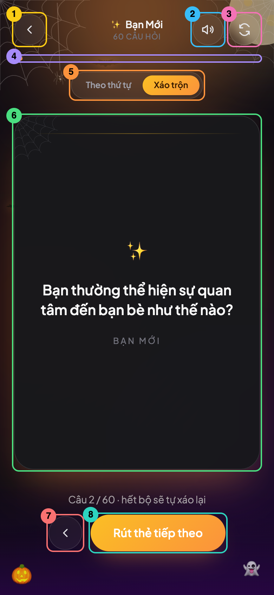
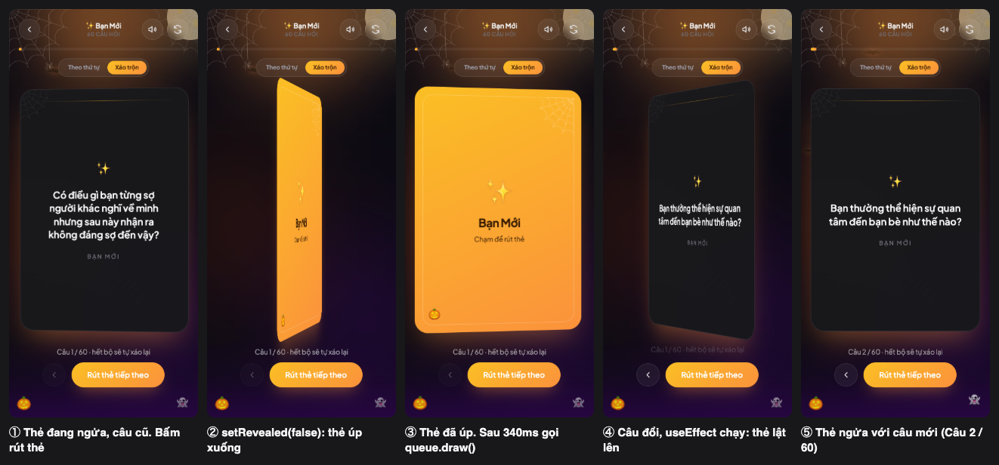

# 10. `GameScreen`: điều phối logic, âm thanh và animation

**File trong bài:** [src/components/GameScreen.tsx](../src/components/GameScreen.tsx)

**Sau bài này, bạn sẽ hiểu:** `useRef`, cách phối hợp code bất đồng bộ với render, closure trong thực tế, và lý do tồn tại của từng biến trông có vẻ thừa.

Bài này có nhiều thí nghiệm "xóa đi xem hỏng gì". Những mục ghi "Kiểm chứng" và các bảng số liệu đều đến từ việc chạy thật trên trình duyệt.



## 1. Vấn đề cần giải quyết

Khi bấm "Rút thẻ tiếp theo" lúc thẻ đang ngửa, người chơi cần thấy theo thứ tự: thẻ úp xuống, câu cũ bị che, rồi thẻ lật lên với câu mới. Khó ở chỗ `useDeckQueue` đổi dữ liệu ngay tức khắc, trong khi animation cần thời gian. Nếu không xử lý, câu mới sẽ lộ ra trước khi thẻ kịp úp.

`GameScreen` phải phối hợp ba hệ thống có nhịp khác nhau:

```text
Dữ liệu    (useDeckQueue)  →  đổi tức thì
Animation  (Motion)        →  kéo dài 650ms
Âm thanh   (useCardSound)  →  phát ngay khi gọi
```

## 2. `useRef`: vì sao `pending` không phải state

Năm "biến" ở đầu component:

```tsx
const queue = useDeckQueue(deck.id, deck.questions, deck.defaultOrder)
const { play: playFlipSound, muted, toggleMuted } = useCardSound()
const [revealed, setRevealed] = useState(queue.currentQuestion !== null)
const [displayed, setDisplayed] = useState<string | null>(queue.currentQuestion)
const pending = useRef(false)
```

`{ play: playFlipSound, ... }` là destructuring kèm đổi tên: lấy trường `play` và gọi nó là `playFlipSound` trong file này.

`useRef` tạo ra một cái hộp có trường `.current`. Hộp này được giữ qua các lần render, tương tự state. Khác biệt nằm ở hai điểm:

| | `useState` | `useRef` |
|---|---|---|
| Đổi giá trị có gây render lại? | Có | **Không** |
| Giá trị mới có ngay sau khi đổi? | Không, phải chờ lần render sau | **Có, ngay lập tức** |
| Được dùng để hiển thị? | Có | Không nên |

`pending` dùng để chặn bấm liên tục trong lúc đang xử lý. Trước hết, hãy xem vì sao cần chặn.

**Kiểm chứng:** tôi xóa dòng `if (pending.current) return` trong `handleDraw`, rồi bấm đúp nút rút thẻ lúc đang ở câu 1. Kết quả là `Câu 3 / 60`: người chơi đã **bị bỏ qua mất một câu**. Với code gốc, kết quả là `Câu 2 / 60` như mong muốn.

Vậy vì sao không dùng state cho khóa này? Giả sử viết như sau:

```tsx
const handleDraw = () => {
  if (isPending) return        // Đọc từ bức ảnh của lần render hiện tại
  setIsPending(true)           // Chỉ có hiệu lực ở lần render sau
  ...
}
```

Tôi đã thử chính phiên bản này và so sánh với code gốc:

| Cách bấm | Khóa bằng ref (code gốc) | Khóa bằng state |
|---|---|---|
| Bấm đúp bằng chuột, từ câu 1 | Câu 2, đúng | Câu 2, đúng |
| Gọi `click()` hai lần liên tiếp trong cùng một đoạn code, từ câu 2 | Câu 3, đúng | **Câu 4, bỏ mất một câu** |

Dòng đầu cho thấy state vẫn chạy đúng với click thật. Với các sự kiện như click, React xử lý xong cập nhật state trước khi sự kiện tiếp theo chạy, nên cú bấm thứ hai đã thấy giá trị mới. Dòng hai cho thấy giới hạn của cách này: khi không có lần render nào xen vào giữa, cả hai lời gọi đều đọc thấy `false` từ cùng một bức ảnh. Còn `pending.current = true` thì có hiệu lực ngay với lần đọc kế tiếp, không phụ thuộc vào việc React đã render hay chưa.

Ref là lựa chọn đúng vì hai lý do: giao diện không hiển thị gì từ khóa này nên không cần render thêm, và khóa không phải dựa vào thời điểm render.

**Quy tắc chọn:** nếu giá trị ảnh hưởng tới những gì hiển thị, dùng state. Nếu chỉ là ghi nhớ nội bộ cho logic, dùng ref.

## 3. `useEffect`: chốt của cả quy trình

```tsx
useEffect(() => {
  if (!pending.current) return
  pending.current = false
  setDisplayed(queue.currentQuestion)
  setRevealed(queue.currentQuestion !== null)
  // eslint-disable-next-line react-hooks/exhaustive-deps
}, [queue.actionCount])
```

Effect này có nghĩa là: **"Sau khi một hành động đã được áp dụng vào dữ liệu, hãy hiển thị kết quả và mở khóa."**

Nó phải nằm trong effect vì `queue.draw()` chỉ xếp lịch cập nhật. Ngay sau khi gọi, `queue.currentQuestion` trong hàm xử lý vẫn là giá trị cũ. Giá trị mới chỉ có ở lần render sau, và effect chính là nơi đọc được nó.

### Vì sao theo dõi `actionCount` mà không phải `currentQuestion`?

Cách có vẻ tự nhiên hơn là dùng `[queue.currentQuestion]`. Vấn đề là **một hành động không phải lúc nào cũng làm đổi câu hỏi**:

| Tình huống | `currentQuestion` có đổi? |
|---|---|
| Bấm làm lại khi chưa rút lá nào | Không: `null` thành `null` |
| Bộ bài chỉ có 1 câu, rút tiếp | Không: vẫn là câu đó |
| `goBack` ở lá đầu tiên | Không |

Nếu câu hỏi không đổi, effect không chạy, `pending` mãi là `true`, và mọi nút bị **khóa vĩnh viễn**.

**Kiểm chứng:** tôi đổi dependency thành `[queue.currentQuestion]`, bấm làm lại khi chưa rút lá nào, rồi bấm rút thẻ. Kết quả là dòng trạng thái vẫn là "Chạm vào lá bài để rút câu hỏi đầu tiên": **app đã bị kẹt**, và không còn phản hồi cú bấm nào nữa.

`actionCount` là một bộ đếm luôn tăng sau mỗi hành động, nên nó đóng vai trò như một tín hiệu "hành động đã xong" đáng tin cậy, bất kể dữ liệu có đổi hay không. Comment ở [useDeckQueue.ts:49](../src/hooks/useDeckQueue.ts#L49) cũng ghi rõ ý này.

`setMode` không tăng `actionCount`, vì đổi chế độ không ảnh hưởng tới lá hiện tại và không đi qua `pending`.

`if (!pending.current) return` đảm bảo effect không làm gì khi component vừa mount, vì lúc đó không có hành động nào đang chờ.

## 4. Theo dõi một cú bấm từ đầu đến cuối

### Ba hàm xử lý

```tsx
const handleDraw = () => {
  if (pending.current) return        // Đang bận? Bỏ qua
  pending.current = true             // Khóa
  playFlipSound()
  if (!revealed) {
    queue.draw()                     // Thẻ đang úp: rút luôn
  } else {
    setRevealed(false)               // Thẻ đang ngửa: úp xuống trước
    window.setTimeout(() => {
      playFlipSound()
      queue.draw()                   // Rồi mới rút
    }, FLIP_HALF_MS)
  }
}
```

`handleBack` có cấu trúc giống hệt, chỉ khác lệnh `queue.goBack()` và có thêm điều kiện `canGoBack`. `handleReset` thì luôn úp thẻ trước và không có âm thanh thứ hai.

### Dòng thời gian

Đây là số liệu đo thật trong trình duyệt, khi rút từ câu 1 sang câu 2. Số đo được lấy ở chế độ dev, đã trừ độ trễ khoảng 65ms của công cụ tự động bấm, và thay đổi đôi chút giữa các lần chạy:

```text
Thời điểm  Sự kiện                                    Góc thẻ   Trên màn hình
─────────────────────────────────────────────────────────────────────────────
0ms        Bấm. pending=true, phát âm thanh           180°      Câu 1
           setRevealed(false)
           → Render 1, Motion bắt đầu xoay về 0°

~85ms      (đã tính ở bài 08) Thẻ nằm ngang             90°      Bìa bắt đầu hiện
                                                                 Câu 1 đã bị che

340ms      setTimeout chạy: âm thanh, queue.draw()    ~6°       Bìa
           → Render 2: currentQuestion mới,
             displayed vẫn là câu cũ
           → Effect chạy vì actionCount đổi:
             pending=false, setDisplayed, setRevealed(true)
           → Render 3

~350ms     Nội dung mặt sau đổi sang câu 2            ~16°      Bìa
           Motion bắt đầu xoay lên 180°

~615ms     Dòng chữ đổi thành "Câu 2 / 60"            ~168°     Câu 2
           (do AnimatePresence chờ 250ms exit)
```

Bạn có thể đối chiếu với ảnh chụp các bước:



### Bảng các lần render

| Render | Lý do | `revealed` | `displayed` | `queue.currentQuestion` |
|---|---|---|---|---|
| 0 | Trước khi bấm | `true` | Câu 1 | Câu 1 |
| 1 | `setRevealed(false)` | `false` | Câu 1 | Câu 1 |
| 2 | `queue.draw()` | `false` | Câu 1 | **Câu 2** |
| 3 | Effect đặt state | **`true`** | **Câu 2** | Câu 2 |

Trong render 2, `setState` và `setActionCount` được gom lại làm **một** lần render, kể cả khi chúng nằm trong `setTimeout`. Đây là tính năng automatic batching của React.

### Ý nghĩa thực sự của `displayed`

[Tài liệu 01](01-overview.md) viết rằng `displayed` cần tách riêng để không lộ câu mới trước khi thẻ úp. Hãy xem thí nghiệm để hiểu chính xác hơn:

| Thí nghiệm | Lúc câu hỏi đổi, thẻ đang ở góc | Có lộ câu mới không? |
|---|---|---|
| Code gốc | khoảng 16° | Không |
| Bỏ `displayed`, truyền thẳng `queue.currentQuestion`, **giữ `setTimeout`** | khoảng 5° | **Không** |
| Giữ `displayed`, **bỏ `setTimeout`**, gọi `draw()` ngay | khoảng 174° | **Có, lộ ngay** |

Vậy thứ thật sự ngăn việc lộ câu hỏi là **độ trễ `setTimeout`**, vì nó trì hoãn việc đổi dữ liệu đến khi thẻ đã úp. Dòng cuối của bảng cho thấy chỉ có `displayed` thì không đủ: effect chạy ngay sau `draw()` nên `displayed` cũng đổi ngay. Trong code hiện tại, `displayed` chủ yếu làm rõ ý định: "câu đang in trên thẻ" là một khái niệm tách biệt với "câu hiện tại trong dữ liệu". Nó cũng quyết định khi nào hiển thị `Bắt đầu` và dòng trạng thái.

Điều rút ra ở đây không chỉ là về `displayed`, mà về cách học: **đừng tin một lời giải thích chỉ vì nó nghe hợp lý, kể cả trong tài liệu này. Hãy tự xóa thử.**

Nếu thẻ đang úp sẵn thì sao? Nhánh `!revealed` gọi `draw()` ngay. Không có gì để che, và mặt sau đang ẩn, nên câu mới được đặt lên đó trong khi thẻ bắt đầu lật lên.

## 5. Stale closure: một lỗi nhỏ có thật trong code

Trong [bài 05](05-tu-duy-react-qua-app.md#4-usestate-và-chu-trình-render), bạn đã biết mỗi lần render giống một bức ảnh chụp. Hàm được tạo trong lần render đó sẽ nhớ các giá trị của bức ảnh đó, kể cả khi nó chạy sau này. Đây là closure, và khi giá trị đã nhớ không còn đúng thì gọi là **stale closure**.

Hãy xem `handleDraw`:

```tsx
playFlipSound()                 // Âm thanh 1
setRevealed(false)
window.setTimeout(() => {
  playFlipSound()               // Âm thanh 2: dùng hàm từ bức ảnh lúc BẤM
  queue.draw()
}, FLIP_HALF_MS)
```

`playFlipSound` là một `useCallback` phụ thuộc vào `muted`. Hàm trong `setTimeout` giữ bản của lần render lúc bấm, khi `muted` còn là `false`. Vậy nếu bấm rút thẻ rồi bấm tắt tiếng ngay trong vòng 340ms thì sao?

**Kiểm chứng:** tôi đếm số `OscillatorNode` được tạo. Mỗi lần phát âm thanh tạo 2 node. Bấm rút thẻ rồi tắt tiếng sau 60ms: có **4 node** được tạo, tức là âm thanh thứ hai **vẫn phát dù đã tắt tiếng**.

Lỗi này gần như vô hại, nhưng đây chính là cơ chế gây ra nhiều lỗi thật sự khó tìm trong React. Vì sao `queue.draw` trong cùng `setTimeout` lại không bị vấn đề này? Vì `draw` dùng updater function, luôn nhận state mới nhất qua `prev`, như đã học ở [bài 09](09-use-deck-queue.md#5-các-hành-động-và-updater-function).

Tương tự, `revealed` trong `handleDraw` cũng là giá trị của bức ảnh chụp, nhưng không gây vấn đề vì nó chỉ được đọc ngay lúc bấm.

## 6. Các giá trị suy ra

```tsx
const isOrdered = queue.mode === 'ordered'
const orderOptions: { value: DeckOrder; label: string }[] = [...]
const progress = queue.total > 0 ? Math.min(1, queue.drawnCount / queue.total) : 0
```

Đều là các giá trị được tính lại mỗi lần render, không dùng state. Trong `progress`:

- `queue.total > 0` tránh phép chia cho 0 khi bộ bài rỗng.
- `Math.min(1, ...)` đảm bảo không vượt 100%. Thực tế `drawnCount` không vượt quá `total`, nên đây là code phòng thủ.

Khi `drawnCount` từ 60 quay về 1 sau khi hết bộ, thanh tiến trình sẽ chạy ngược về gần đầu, và dòng trạng thái có câu "hết bộ sẽ tự xáo lại" để báo trước.

## 7. Đọc phần JSX

```text
<div>                          Khung ngoài, chiều cao tối thiểu bằng màn hình
├── Quầng sáng                 Màu lấy từ deck.glow
├── <header>
│   ├── Nút quay lại           onClick={onBack}, gọi callback của App
│   ├── <div opacity-0>        Khối trống để cân giữa tiêu đề
│   ├── Tên bộ bài, số câu
│   ├── Nút âm thanh           icon đổi theo muted
│   └── Nút làm lại
├── Thanh tiến trình           motion.div, animate width
├── Chọn chế độ                role="radiogroup"
└── <main>
    ├── PlayingCard            question={displayed} revealed={revealed}
    └── Trạng thái, các nút
```

### Khối trống để cân đối

[Dòng 97](../src/components/GameScreen.tsx#L97) có một `div` vô hình kích thước bằng một nút. Lý do là bên phải có hai nút, bên trái chỉ có một, nên phải thêm một khối trống để tiêu đề nằm chính giữa nhờ `justify-between`.

### Dòng trạng thái có `key`

```tsx
<AnimatePresence mode="wait">
  <motion.p key={displayed === null ? 'empty' : queue.drawnCount} ...>
```

Đây là một mẹo hay: `key` đổi theo số thứ tự câu. Với mỗi câu mới, React coi đây là phần tử mới, còn `AnimatePresence` chạy hiệu ứng rời đi cho dòng cũ và hiệu ứng xuất hiện cho dòng mới. **Đổi `key` là cách để chủ động kích hoạt animation**.

### Nút được render có điều kiện

```tsx
{displayed !== null && (
  <button onClick={handleBack} disabled={!queue.canGoBack} ...>
```

Có hai mức ở đây, và chúng khác nhau:

- Chưa rút lá nào: nút **không tồn tại**.
- Đang ở lá đầu tiên: nút tồn tại nhưng **bị vô hiệu hóa**, với `disabled:opacity-30` làm mờ đi.

### Nhóm radio

```tsx
<div role="radiogroup" aria-label="Thứ tự rút bài">
  {orderOptions.map((option) => {
    const active = queue.mode === option.value
    return (
      <button role="radio" aria-checked={active} ...>
```

Về hình thức đây là hai nút, nhưng về ý nghĩa là chọn một trong hai. Các thuộc tính `role` giúp trình đọc màn hình hiểu đúng ý nghĩa đó. Dạng `.map()` này có thân hàm `{ ... return }` chứ không phải `( ... )`, vì cần một biến trung gian `active`.

## 8. Khôi phục sau khi tải lại trang

```tsx
const [revealed, setRevealed] = useState(queue.currentQuestion !== null)
const [displayed, setDisplayed] = useState<string | null>(queue.currentQuestion)
```

Thứ tự gọi hook ở đây có ý nghĩa: `useDeckQueue` chạy trước, nên kết quả của nó dùng được cho `useState` ở dòng sau.

Khi vào lại một bộ đang chơi dở, `currentQuestion` có giá trị ngay từ lần render đầu, nên thẻ mở ngửa sẵn với đúng câu cũ. Tôi đã kiểm chứng: rút tới câu 2, tải lại trang, chọn lại bộ đó, thì app hiện đúng `Câu 2 / 60`.

## 9. Những điểm có thể làm tốt hơn

| Điểm yếu | Hệ quả | Mức độ |
|---|---|---|
| `setTimeout` không được dọn khi unmount | Bấm rút thẻ rồi quay lại ngay, âm thanh thứ hai vẫn phát dù bạn đã bấm rời màn hình | Nhỏ |
| `handleDraw` và `handleBack` lặp code | Sửa một chỗ phải nhớ sửa chỗ kia | Nhỏ |
| `FLIP_HALF_MS` tách khỏi `duration: 0.65` ở `PlayingCard` | Đổi tốc độ lật phải nhớ xem lại cả hai | Nhỏ |
| Stale closure của âm thanh | Tắt tiếng trong 340ms vẫn nghe một tiếng | Rất nhỏ |

Bạn sẽ tự sửa hai điểm đầu trong [bài tập lớn ở bài 13](13-tong-hop.md#4-bài-tập-lớn).

## Thử ngay

Ba thí nghiệm đầu đã được kiểm chứng. Hãy tự làm để tận mắt thấy:

1. **Xóa khóa:** bỏ `if (pending.current) return` trong `handleDraw`, rồi bấm đúp khi thẻ đang ngửa. Bạn sẽ bị bỏ mất một câu.
2. **Làm kẹt app:** đổi `[queue.actionCount]` thành `[queue.currentQuestion]`. Khi chưa rút lá nào, bấm nút làm lại, rồi bấm rút thẻ. App sẽ không phản hồi.
3. **Làm lộ câu hỏi:** trong nhánh `else` của `handleDraw`, thay cả khối `setTimeout` bằng `queue.draw()`. Câu mới sẽ hiện ra ngay trong khi thẻ còn đang ngửa.
4. **Bỏ `displayed`:** chỉ đổi thành `question={queue.currentQuestion}`, giữ `setTimeout`. Mắt thường khó phân biệt được với bản gốc.
5. **Theo dõi render:** thêm `console.log('render', revealed, displayed?.slice(0, 15), queue.currentQuestion?.slice(0, 15))` vào đầu component, rồi đối chiếu với bảng các lần render ở trên. Do `StrictMode`, mỗi lần render có thể được ghi hai dòng. `?.` là optional chaining: nếu giá trị là `null`, biểu thức trả về `undefined` thay vì báo lỗi.

## Tự kiểm tra

<details>
<summary>1. Vì sao <code>pending</code> là ref thay vì state?</summary>

Vì nó không ảnh hưởng tới hiển thị, nên không cần render lại. Ngoài ra, ref có hiệu lực ngay lập tức, còn state chỉ đổi ở lần render sau. Với click thật, khóa bằng state vẫn chạy đúng, nhưng hai lời gọi liên tiếp không có render xen giữa sẽ lọt qua được.
</details>

<details>
<summary>2. Nếu effect phụ thuộc vào <code>queue.currentQuestion</code>, kịch bản cụ thể nào làm app bị kẹt?</summary>

Bấm làm lại khi chưa rút lá nào. `handleReset` đặt `pending = true`, `currentQuestion` vẫn là `null`, effect không chạy, nên `pending` không bao giờ được trả về `false`.
</details>

<details>
<summary>3. <code>handleDraw</code> gọi <code>queue.draw()</code> và ngay sau đó đọc <code>queue.currentQuestion</code>, thì sẽ nhận giá trị nào?</summary>

Giá trị cũ. `draw()` chỉ xếp lịch cập nhật, và biến `queue` trong closure hiện tại là của lần render trước. Đó là lý do kết quả được đọc trong effect, sau lần render tiếp theo.
</details>

<details>
<summary>4. Chính xác thì cái gì ngăn câu mới bị lộ trong lúc thẻ úp xuống?</summary>

Độ trễ của `setTimeout`: dữ liệu chỉ đổi sau 340ms, khi thẻ đã qua mốc 90° từ lâu. Thí nghiệm cho thấy bỏ `displayed` nhưng giữ độ trễ thì vẫn không lộ, còn bỏ độ trễ thì lộ ngay dù vẫn giữ `displayed`.
</details>

<details>
<summary>5. Vì sao âm thanh thứ hai vẫn phát dù đã tắt tiếng, trong khi <code>queue.draw</code> trong cùng closure lại không dùng dữ liệu cũ?</summary>

`playFlipSound` kiểm tra `muted` trong closure của lần render lúc bấm, nên thấy giá trị cũ. `queue.draw` dùng updater function nên React đưa state mới nhất qua `prev`, không phụ thuộc vào closure.
</details>

---

**Bài tiếp theo:** [11. HalloweenDecor](11-halloween-decor.md)
